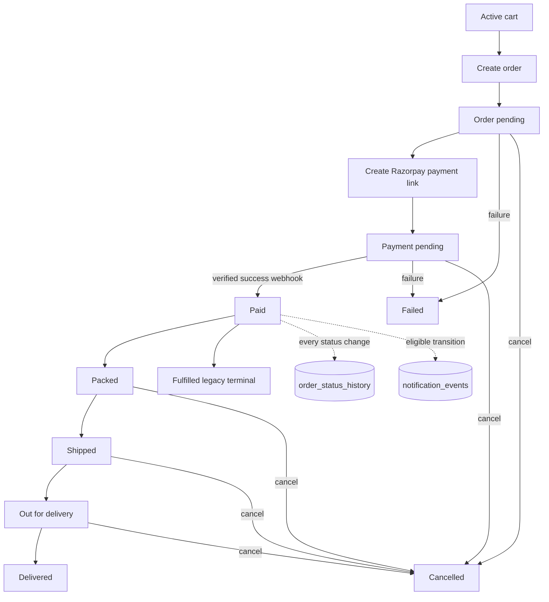
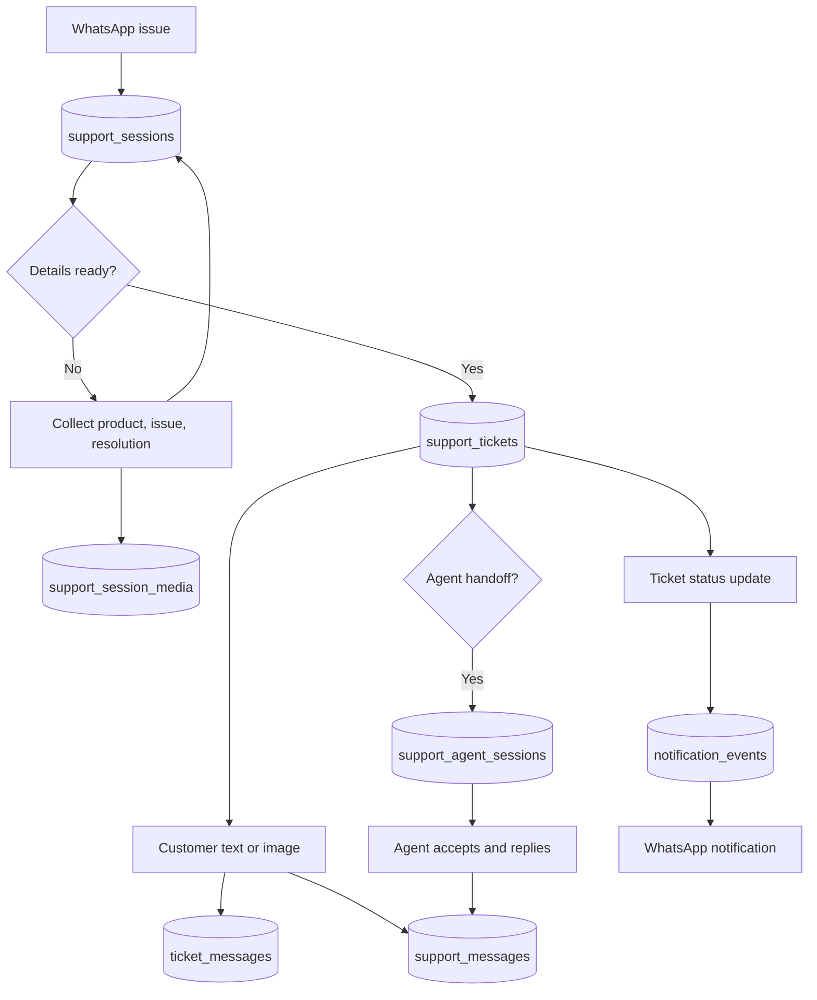
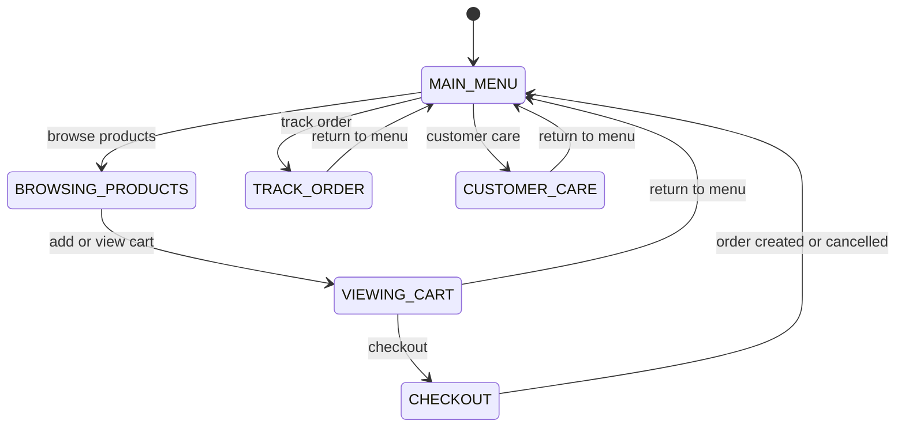
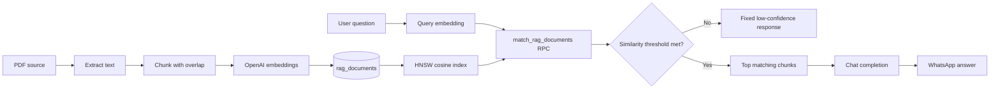
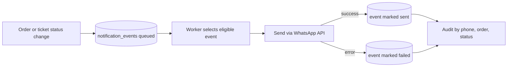
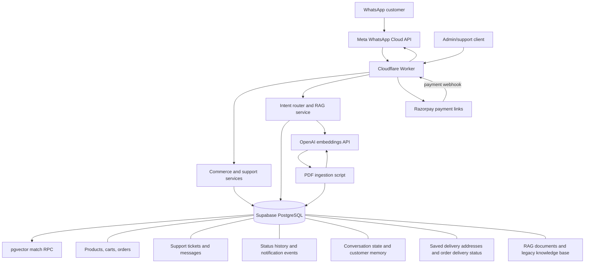

# Database Architecture and Data Model

> **Audience:** application developers, QA, support, operations, and stakeholders
>
> **Scope:** database model and observed persistence behavior in the WhatsApp commerce bot. This document describes the checked-in Supabase SQL and application code; it does not assert that production has applied every migration.

## 1. Executive summary

The application uses one shared Supabase PostgreSQL database. The relational model covers customers, product catalog, carts, orders, support, notifications, delivery, and conversation state, plus a pgvector store for retrieval-augmented generation (RAG). Data access is performed directly through `@supabase/supabase-js` in the Cloudflare Worker and an ingestion script; there is no ORM, generated repository layer, or separate payment database.

The migration sequence is the best available schema contract, but several migration/code mismatches mean the deployed schema should be checked before relying on support-session status constraints or legacy order columns. Payment provider state is stored on `orders`; actual payment processing is external to PostgreSQL.

### Evidence reviewed

- All 15 SQL migrations under `supabase/migrations/`.
- The root `rag-setup.sql` bootstrap/seed script.
- Data access and business logic in `src/commerce.ts`, `src/commerce-tools.ts`, `src/commerce-memory.ts`, `src/rag.ts`, `src/index.ts`, and `src/ai-commerce-router.ts`.
- PDF ingestion in `scripts/ingest-pdf.ts`, TypeScript record interfaces, package configuration, and available tests.

No Prisma schema, other ORM entity layer, database repository abstraction, explicit SQL transaction wrapper, or separate payment table was found.

## 2. Database configuration and ownership

| Concern | Observed design |
|---|---|
| Database | Supabase PostgreSQL (`public` schema); pgvector extension for semantic retrieval. |
| Client | `@supabase/supabase-js`; worker and ingestion script connect using the Supabase service-role key. |
| ORM / migrations | No ORM. Versioned SQL files `001` through `014` in `supabase/migrations/` are the schema evolution source. `rag-setup.sql` is an additional bootstrap/seed script, not a numbered migration. |
| Runtime data owner | A single Cloudflare Worker owns writes for commerce, conversations, support, and notifications. |
| RAG data owner | `scripts/ingest-pdf.ts` writes document chunks; `src/rag.ts` embeds queries and invokes `match_rag_documents`. |
| External persistence | Razorpay holds payment-link/payment details; Meta/WhatsApp handles message delivery and media. No provider-owned payment or message table is present in this schema. |
| Authorization | Migrations enable RLS on application tables and grant broad `FOR ALL` policies to `service_role`. Application code uses that privileged key, so protection depends on keeping it server-side and validating access before database operations. |
| Connection pooling / cache | No project-defined database pool, ORM cache, Redis, or application caching layer was found. Supabase owns database connection management. |
| Transaction boundary | Application workflows make multiple Supabase REST calls; no multi-table transaction or stored procedure is used for order creation/status changes/support conversion. Individual conditional updates are used in some concurrency-sensitive paths. |
| Seed data | `001_commerce_schema.sql` seeds four products and four knowledge-base rows. `rag-setup.sql` seeds knowledge-base policy/FAQ rows. Both use conflict avoidance, but there is no explicit environment-specific seed pipeline. |

### Data ownership by bounded context

| Bounded context / module | Tables owned or written | Persistence implementation |
|---|---|---|
| Commerce (`src/commerce.ts`, `src/commerce-tools.ts`) | `customers`, `products`, `carts`, `cart_items`, `orders`, `order_items`, `order_status_history` | Direct Supabase client calls; no ORM/cache. |
| WhatsApp conversation (`src/commerce.ts`, `src/index.ts`) | `conversation_state`; commerce memory also uses `conversation_context` and `customer_profiles` | Direct Supabase calls; state is keyed by phone number. |
| Customer support (`src/commerce.ts`, `src/index.ts`) | `support_sessions`, `support_session_media`, `support_tickets`, `ticket_messages`, `support_messages`, `support_agent_sessions` | Direct Supabase calls; two message-history tables serve different code paths. |
| Notification delivery (`src/commerce.ts`, `src/index.ts`) | `notification_events` | Event rows are persisted and processed by Worker logic; not a separately deployed queue consumer. |
| RAG (`src/rag.ts`, `scripts/ingest-pdf.ts`) | `rag_documents`; legacy `knowledge_base` remains in SQL but is not queried by current retrieval code | Supabase RPC for reads, batched OpenAI embeddings for ingestion/query, pgvector HNSW index. |
| Delivery (`src/commerce.ts`, `src/index.ts`) | `delivery_addresses`, `order_delivery_details` (migration `015_delivery_addresses.sql`) | Customer-owned address records and one unique delivery record per order; collection progress is stored in `conversation_state`. |
| Webhook idempotency | `processed_webhook_events` exists in the initial schema; no active reference was found in current application source | Schema-only / apparently unused. |

## 3. Entity relationship diagram

```mermaid
erDiagram
    customers o|--o{ carts : "owns"
    customers o|--o{ orders : "places"
    carts ||--o{ cart_items : "contains"
    products ||--o{ cart_items : "selected as"
    orders ||--o{ order_items : "contains"
    products o|--o{ order_items : "snapshot source"
    products o|--o{ knowledge_base : "may describe"
    orders ||--o{ order_status_history : "status audit"
    orders o|--o{ notification_events : "may trigger"
    customers o|--o{ support_tickets : "may open"
    orders o|--o{ support_tickets : "may concern"
    support_tickets ||--o{ ticket_messages : "has media messages"
    support_tickets ||--o{ support_messages : "has chat messages"
    support_tickets ||--o{ support_agent_sessions : "has agent handoffs"
    customers o|--o{ support_sessions : "may start"
    orders o|--o{ support_sessions : "may concern"
    support_sessions ||--o{ support_session_media : "collects media"
    orders o|--o{ conversation_context : "last order context"
    orders o|--o{ customer_profiles : "last order summary"
    customers ||--o{ delivery_addresses : "saves"
    orders ||--|| order_delivery_details : "delivery record"
    delivery_addresses o|--o{ order_delivery_details : "assigned to"
    customers {
        bigint id PK
        text whatsapp_number UK
        text name
        text email
        jsonb metadata
        timestamptz created_at
        timestamptz updated_at
    }
    products {
        bigint id PK
        text name
        text sku UK
        text description
        text category
        numeric price
        integer stock
        boolean is_active
        text image_url
        jsonb metadata
    }
    carts {
        bigint id PK
        bigint customer_id FK
        text customer_phone
        text status
        timestamptz created_at
        timestamptz updated_at
    }
    cart_items {
        bigint id PK
        bigint cart_id FK
        bigint product_id FK
        text product_name
        numeric unit_price
        integer quantity
    }
    orders {
        bigint id PK
        bigint customer_id FK
        text customer_phone
        text status
        numeric subtotal
        numeric tax
        numeric total_amount
        text currency
        text payment_provider
        text razorpay_payment_link_id
        text razorpay_payment_id
    }
    order_items {
        bigint id PK
        bigint order_id FK
        bigint product_id FK
        text product_name
        numeric unit_price
        integer quantity
        numeric line_total
    }
    knowledge_base {
        bigint id PK
        bigint product_id FK
        text title
        text content
        text source_type
        text category
        jsonb metadata
    }
    conversation_state {
        bigint id PK
        text whatsapp_number UK
        text state
        jsonb context
        text last_message
    }
    processed_webhook_events {
        bigint id PK
        text event_id UK
        text event_type
        timestamptz created_at
    }
    order_status_history {
        bigint id PK
        bigint order_id FK
        text previous_status
        text new_status
        text changed_by
        text changed_by_role
        jsonb metadata
    }
    notification_events {
        bigint id PK
        bigint order_id FK
        text customer_phone
        text event_type
        text channel
        text status
        jsonb payload
    }
    rag_documents {
        bigint id PK
        text source
        integer chunk_index
        text content
        vector1536 embedding
        jsonb metadata
    }
    support_tickets {
        bigint id PK
        text ticket_number UK
        bigint customer_id FK
        text customer_phone
        bigint order_id FK
        text issue_type
        text priority
        text status
        text image_url
    }
    ticket_messages {
        bigint id PK
        bigint ticket_id FK
        text sender_type
        text message
        text message_type
        text media_id
        text image_url
    }
    support_sessions {
        bigint id PK
        bigint customer_id FK
        text customer_phone
        bigint order_id FK
        text issue_type
        text status
        text current_step
        jsonb collected_data
    }
    support_session_media {
        bigint id PK
        bigint support_session_id FK
        text media_id
        text image_url
        text mime_type
    }
    support_messages {
        bigint id PK
        bigint ticket_id FK
        text sender_type
        text sender_id
        text message_text
        timestamptz created_at
    }
    support_agent_sessions {
        bigint id PK
        bigint ticket_id FK
        text customer_phone
        text agent_id
        text status
    }
    conversation_context {
        text phone_number PK
        bigint last_order_id FK
        text last_product
        text last_intent
        timestamptz updated_at
    }
    customer_profiles {
        text phone_number PK
        integer total_orders
        numeric total_spent
        text favorite_category
        text favorite_product
        bigint last_order_id FK
    }
    delivery_addresses {
        bigint id PK
        bigint customer_id FK
        text recipient_name
        text recipient_phone
        text email
        text address_line_1
        text address_line_2
        text city
        text state
        text pincode
        text landmark
        timestamptz created_at
        timestamptz updated_at
    }
    order_delivery_details {
        bigint id PK
        bigint order_id FK
        bigint delivery_address_id FK
        text customer_response
        text delivery_status
        timestamptz created_at
        timestamptz updated_at
    }
```

<!-- mermaid-checked: every attribute is `<type> <name> [<key>] ["<description>"]` with at most one of PK/FK/UK, no \n in descriptions, no {} in descriptions, every relationship label is double-quoted -->


**Reading the ERD:** arrows represent only declared foreign keys. Phone-number fields used as logical identifiers are deliberately not shown as foreign keys because the migrations do not enforce those links. `orders` has an optional customer relationship; historic rows can exist without a resolved `customers` record.

## 4. Table-by-table reference

Column nullability and defaults below reflect the checked-in migrations. `NOT NULL` is marked **No** in the Nullable column. For `orders`, `product_id` and `amount` are discussed separately as legacy/deployment-dependent fields because migration `002` alters them but does not define their types or create them.

### Table: `customers`

#### Purpose
Canonical customer identity for commerce and support, uniquely identified by a WhatsApp number.

#### Columns
| Column | Type | Nullable | Description |
|---|---|---:|---|
| `id` | BIGSERIAL | No | Primary key. |
| `whatsapp_number` | TEXT | No | Unique customer phone/WhatsApp identifier. |
| `name` | TEXT | Yes | Optional display name. |
| `email` | TEXT | Yes | Optional email address. |
| `metadata` | JSONB | No | Extensible attributes; defaults to `{}`. |
| `created_at` | TIMESTAMPTZ | No | Defaults to `NOW()`. |
| `updated_at` | TIMESTAMPTZ | No | Defaults to `NOW()`; update trigger refreshes it. |

#### Relationships
- One-to-many: customer to carts, orders, support tickets, and support sessions (all referencing columns are nullable).
- No explicit customer foreign key from `conversation_state`, `conversation_context`, or `customer_profiles`.

#### Referenced By
`carts.customer_id`, `orders.customer_id`, `support_tickets.customer_id`, `support_sessions.customer_id`; each uses `ON DELETE SET NULL`.

#### Constraints and indexes
Primary key `id`; unique constraint on `whatsapp_number`; default `{}` metadata; updated-at trigger. No separate index beyond the unique index.

#### Used In Code
`src/commerce.ts`: `upsertCustomer()` selects/inserts/updates by WhatsApp number; `createOrderFromCart()` stores the resolved customer id on the order. Support session/ticket creation accepts optional customer id.

#### Example Record
```json
{"id":73,"whatsapp_number":"919876543210","name":"Asha Rao","email":null,"metadata":{},"created_at":"2026-01-01T00:00:00Z","updated_at":"2026-01-01T00:00:00Z"}
```

### Table: `products`

#### Purpose
Sellable catalog, price, stock, active flag, and product metadata.

#### Columns
| Column | Type | Nullable | Description |
|---|---|---:|---|
| `id` | BIGSERIAL | No | Primary key. |
| `name` | TEXT | No | Product display name. |
| `sku` | TEXT | Yes | Optional unique stock-keeping identifier. |
| `description` | TEXT | Yes | Product description. |
| `category` | TEXT | Yes | Catalog category. |
| `price` | NUMERIC(12,2) | No | Non-negative current unit price. |
| `stock` | INTEGER | No | Non-negative on-hand quantity; defaults to `0`. |
| `is_active` | BOOLEAN | No | Catalog visibility; defaults to `TRUE`. |
| `image_url` | TEXT | Yes | Product image location. |
| `metadata` | JSONB | No | Extensible attributes; defaults to `{}`. |
| `created_at` | TIMESTAMPTZ | No | Defaults to `NOW()`. |
| `updated_at` | TIMESTAMPTZ | No | Defaults to `NOW()`; update trigger refreshes it. |

#### Relationships
- One-to-many: product to cart items, order items, and optional knowledge-base entries.
- `order_items.product_id` is nullable and uses `ON DELETE SET NULL`; item name and price preserve a historical snapshot.

#### Referenced By
`cart_items.product_id` (`ON DELETE RESTRICT`), `order_items.product_id` (`ON DELETE SET NULL`), `knowledge_base.product_id` (`ON DELETE SET NULL`).

#### Constraints and indexes
Primary key; unique `sku`; `price >= 0`; `stock >= 0`; updated-at trigger. Seeded with four demo catalog records in migration `001`.

#### Used In Code
`src/commerce.ts`: product lookup, cart validation, snapshot pricing, inventory checks. `src/commerce-tools.ts`: product and inventory queries. `src/commerce-memory.ts`: category enrichment. `src/index.ts`: catalog browsing and older single-product checkout path.

#### Example Record
```json
{"id":5,"name":"Innova Smart Speaker","sku":"INN-001","description":"Compact smart speaker","category":"Audio","price":4999.00,"stock":25,"is_active":true,"image_url":null,"metadata":{}}
```

### Table: `carts`

#### Purpose
Stores a customer's editable basket before checkout.

#### Columns
| Column | Type | Nullable | Description |
|---|---|---:|---|
| `id` | BIGSERIAL | No | Primary key. |
| `customer_id` | BIGINT | Yes | Optional FK to `customers.id`. |
| `customer_phone` | TEXT | No | Phone used to find the active cart. |
| `status` | TEXT | No | Defaults to `active`; allowed: `active`, `checked_out`, `abandoned`, `closed`. |
| `created_at` | TIMESTAMPTZ | No | Defaults to `NOW()`. |
| `updated_at` | TIMESTAMPTZ | No | Defaults to `NOW()`; update trigger refreshes it. |

#### Relationships
- Many-to-one optional customer; one-to-many cart items.

#### Referenced By
`cart_items.cart_id` (`ON DELETE CASCADE`).

#### Constraints and indexes
Status check constraint; composite index `idx_carts_customer_phone(customer_phone, status)`; updated-at trigger. There is no unique constraint enforcing one active cart per phone.

#### Used In Code
`src/commerce.ts`: `getActiveCart()`, `createCart()`, add/remove/update/clear operations, `viewCart()`, `createOrderFromCart()`. `src/index.ts` also contains a legacy checkout/cart path.

#### Example Record
```json
{"id":12,"customer_id":73,"customer_phone":"919876543210","status":"active","created_at":"2026-01-01T00:00:00Z","updated_at":"2026-01-01T00:00:00Z"}
```

### Table: `cart_items`

#### Purpose
Basket line items with quantity and the unit price/name captured when added.

#### Columns
| Column | Type | Nullable | Description |
|---|---|---:|---|
| `id` | BIGSERIAL | No | Primary key. |
| `cart_id` | BIGINT | No | Parent cart FK. |
| `product_id` | BIGINT | No | Catalog product FK. |
| `product_name` | TEXT | No | Product name snapshot. |
| `unit_price` | NUMERIC(12,2) | No | Non-negative unit price snapshot. |
| `quantity` | INTEGER | No | Must be greater than zero. |
| `created_at` | TIMESTAMPTZ | No | Defaults to `NOW()`. |
| `updated_at` | TIMESTAMPTZ | No | Defaults to `NOW()`; update trigger refreshes it. |

#### Relationships
- Many-to-one cart and product; unique per `(cart_id, product_id)`.

#### Referenced By
None.

#### Constraints and indexes
FK cart cascades delete; FK product restricts delete; non-negative price; positive quantity; unique `(cart_id, product_id)`; updated-at trigger. No additional explicit indexes.

#### Used In Code
`src/commerce.ts`: cart reads/writes and order conversion. `src/index.ts`: older checkout and cart commands.

#### Example Record
```json
{"id":21,"cart_id":12,"product_id":5,"product_name":"Innova Smart Speaker","unit_price":4999.00,"quantity":2}
```

### Table: `orders`

#### Purpose
Order header, customer contact snapshot, totals, lifecycle status, and Razorpay payment-link references.

#### Columns
| Column | Type | Nullable | Description |
|---|---|---:|---|
| `id` | BIGSERIAL | No | Primary key. |
| `customer_id` | BIGINT | Yes | Optional FK to canonical customer. Added by migration `002`. |
| `customer_phone` | TEXT | No | Customer contact snapshot and common lookup key. |
| `meta_message_id` | TEXT | Yes | WhatsApp message id associated with the order. |
| `status` | TEXT | No | Defaults to `pending`; allowed statuses are described under constraints. |
| `subtotal` | NUMERIC(12,2) | No | Defaults to `0`. |
| `tax` | NUMERIC(12,2) | No | Defaults to `0`. |
| `total_amount` | NUMERIC(12,2) | No | Defaults to `0`; application computes from cart. |
| `currency` | TEXT | No | Defaults to `INR`. |
| `payment_provider` | TEXT | No | Defaults to `razorpay`. |
| `razorpay_payment_link_id` | TEXT | Yes | External payment-link id. |
| `razorpay_payment_link_url` | TEXT | Yes | Customer-facing payment URL. |
| `razorpay_payment_id` | TEXT | Yes | External payment id. |
| `paid_at` | TIMESTAMPTZ | Yes | Payment confirmation time. |
| `created_at` | TIMESTAMPTZ | No | Defaults to `NOW()`. |
| `updated_at` | TIMESTAMPTZ | No | Defaults to `NOW()`; update trigger refreshes it. |
| `product_id` (legacy) | deployment-dependent | deployment-dependent | Referenced by the old single-item checkout code; migration `002` only drops `NOT NULL`, it does not define or add this column. |
| `amount` (legacy) | deployment-dependent | deployment-dependent | Legacy single-item amount referenced by older code; migration `002` only drops `NOT NULL`. |

#### Relationships
- Optional customer; one-to-many order items, status history, and notification events.
- One-to-many support tickets and support sessions may optionally reference the order.
- Conversation memory tables may optionally refer to a last order.

#### Referenced By
`order_items.order_id` (`ON DELETE CASCADE`), `order_status_history.order_id` (`ON DELETE CASCADE`), `notification_events.order_id` (`ON DELETE SET NULL`), `support_tickets.order_id`, `support_sessions.order_id`, `conversation_context.last_order_id`, `customer_profiles.last_order_id` (the latter four use `ON DELETE SET NULL`).

#### Constraints and indexes
Primary key; status check after migrations `001` and `006` permits `pending`, `payment_pending`, `paid`, `failed`, `cancelled`, `fulfilled`, `PACKED`, `SHIPPED`, `OUT_FOR_DELIVERY`, `DELIVERED`; customer FK uses `ON DELETE SET NULL`; phone/created descending index; updated-at trigger. `001` creates subtotal/tax/total/currency/payment provider. `002` adds customer id and relaxes legacy columns.

#### Used In Code
`src/commerce.ts`: create/read/update/status/payment/webhook/history operations. `src/commerce-tools.ts`: latest order/history/payment information. `src/commerce-memory.ts`: spending and order summary aggregation. `src/index.ts`: old and cart checkout, tracking, Razorpay webhook, admin status transitions, and notifications.

#### Example Record
```json
{"id":42,"customer_id":73,"customer_phone":"919876543210","meta_message_id":"wamid.example","status":"payment_pending","subtotal":9998.00,"tax":0,"total_amount":9998.00,"currency":"INR","payment_provider":"razorpay","razorpay_payment_link_id":"plink_example","razorpay_payment_link_url":"https://rzp.io/example","razorpay_payment_id":null,"paid_at":null}
```

### Table: `order_items`

#### Purpose
Immutable-ish purchased line snapshots supporting multi-item orders independently of future catalog changes.

#### Columns
| Column | Type | Nullable | Description |
|---|---|---:|---|
| `id` | BIGSERIAL | No | Primary key. |
| `order_id` | BIGINT | No | Parent order FK. |
| `product_id` | BIGINT | Yes | Optional catalog link. |
| `product_name` | TEXT | No | Purchased-name snapshot. |
| `unit_price` | NUMERIC(12,2) | No | Non-negative purchased unit price. |
| `quantity` | INTEGER | No | Positive purchased quantity. |
| `line_total` | NUMERIC(12,2) | No | Non-negative extended price. |
| `created_at` | TIMESTAMPTZ | No | Defaults to `NOW()`. |

#### Relationships
- Many-to-one order and optional product. Product deletion preserves the line by nulling product id.

#### Referenced By
None.

#### Constraints and indexes
Order FK cascades delete; product FK sets null; unit price and line total non-negative; quantity positive. No explicit `order_id` index is declared in migration `001`.

#### Used In Code
`src/commerce.ts`: `createOrderFromCart()` inserts items. `src/commerce-tools.ts`: embeds items in order retrieval. `src/commerce-memory.ts`: customer purchase summaries. `src/index.ts`: tracking and legacy order display.

#### Example Record
```json
{"id":31,"order_id":42,"product_id":5,"product_name":"Innova Smart Speaker","unit_price":4999.00,"quantity":2,"line_total":9998.00}
```

### Table: `order_status_history`

#### Purpose
Audit timeline for order status changes, including actor, role, reason, and arbitrary metadata.

#### Columns
| Column | Type | Nullable | Description |
|---|---|---:|---|
| `id` | BIGSERIAL | No | Primary key. |
| `order_id` | BIGINT | No | Parent order FK. |
| `previous_status` | TEXT | Yes | Status before change; null for initial event if used that way. |
| `new_status` | TEXT | No | Status after change. |
| `changed_by` | TEXT | Yes | Actor identifier. |
| `changed_by_role` | TEXT | No | Defaults to `admin`. |
| `reason` | TEXT | Yes | Optional reason. |
| `metadata` | JSONB | No | Defaults to `{}`. |
| `created_at` | TIMESTAMPTZ | No | Defaults to `NOW()`. |

#### Relationships
- Many-to-one order; order deletion cascades.

#### Referenced By
None.

#### Constraints and indexes
Index `(order_id, created_at DESC)` and index on `new_status`; RLS enabled with service-role policy. No status enum/check constraint on history text.

#### Used In Code
`src/commerce.ts`: `updateOrderStatus()` writes changes and `getOrderTimeline()` reads them. Status update and history insert are separate requests, not a single database transaction.

#### Example Record
```json
{"id":8,"order_id":42,"previous_status":"paid","new_status":"PACKED","changed_by":"agent-17","changed_by_role":"admin","reason":"Packed for dispatch","metadata":{},"created_at":"2026-01-02T10:00:00Z"}
```

### Table: `notification_events`

#### Purpose
Persisted delivery event/outcome for order and support status notifications.

#### Columns
| Column | Type | Nullable | Description |
|---|---|---:|---|
| `id` | BIGSERIAL | No | Primary key. |
| `order_id` | BIGINT | Yes | Optional order FK. |
| `customer_phone` | TEXT | No | Destination contact. |
| `event_type` | TEXT | No | For example, `order_status_changed` or `support_ticket_status_changed`. |
| `channel` | TEXT | No | Defaults to `whatsapp`. |
| `status` | TEXT | No | Defaults to `queued`; `queued`, `sent`, `failed`, `delivered`, or `skipped`. |
| `related_status` | TEXT | Yes | Associated order/ticket status. |
| `payload` | JSONB | No | Defaults to `{}`; event data and, for order notices, rendered message. |
| `reason` | TEXT | Yes | Delivery/error reason. |
| `created_at` | TIMESTAMPTZ | No | Defaults to `NOW()`. |
| `sent_at` | TIMESTAMPTZ | Yes | Time message was sent. |
| `updated_at` | TIMESTAMPTZ | No | Defaults to `NOW()`; trigger refreshes it. |

#### Relationships
- Optional many-to-one order. Support events may link to an order if the related ticket has one; there is no ticket FK.

#### Referenced By
None.

#### Constraints and indexes
Status check; indexes on `(order_id, created_at DESC)`, `(customer_phone, created_at DESC)`, `(status, created_at DESC)`; update trigger; RLS/service-role policy.

#### Used In Code
`src/commerce.ts`: queues order status event. `src/index.ts`: finds queued events, sends WhatsApp messages, and updates event status for order and support-ticket transitions. The delivery processing is in the Worker; there is no independent notification service.

#### Example Record
```json
{"id":101,"order_id":42,"customer_phone":"919876543210","event_type":"order_status_changed","channel":"whatsapp","status":"sent","related_status":"SHIPPED","payload":{"order_id":42,"new_status":"SHIPPED"},"reason":null,"sent_at":"2026-01-03T09:00:00Z"}
```

### Table: `support_tickets`

#### Purpose
Formal customer issue record with ticket number, issue details, priority, order/customer links, and lifecycle status.

#### Columns
| Column | Type | Nullable | Description |
|---|---|---:|---|
| `id` | BIGSERIAL | No | Primary key. |
| `ticket_number` | TEXT | No | Unique human-facing ticket identifier. |
| `customer_id` | BIGINT | Yes | Optional customer FK. |
| `customer_phone` | TEXT | No | Customer contact snapshot and lookup key. |
| `order_id` | BIGINT | Yes | Optional related order FK. |
| `issue_type` | TEXT | No | Required issue category. |
| `issue_description` | TEXT | Yes | Customer issue narrative. |
| `product_name` | TEXT | Yes | Product label snapshot; not an FK. |
| `preferred_resolution` | TEXT | Yes | Requested resolution. |
| `priority` | TEXT | No | Defaults to `NORMAL`; `LOW`, `NORMAL`, `HIGH`, or `URGENT`. |
| `status` | TEXT | No | Defaults to `OPEN`; allowed statuses include `WAITING_AGENT` after migration `012`. |
| `created_at` | TIMESTAMPTZ | No | Defaults to `NOW()`. |
| `updated_at` | TIMESTAMPTZ | No | Defaults to `NOW()`; trigger refreshes it. |
| `resolved_at` | TIMESTAMPTZ | Yes | Resolution timestamp. |
| `image_url` | TEXT | Yes | Added by migration `010`; optional ticket-level media pointer. |

#### Relationships
- Optional many-to-one customer and order; one-to-many ticket messages, support messages, and agent sessions.

#### Referenced By
`ticket_messages.ticket_id`, `support_messages.ticket_id`, and `support_agent_sessions.ticket_id`; these cascade on ticket deletion.

#### Constraints and indexes
`ticket_number` unique; priority/status check constraints; indexes by customer phone/time, customer id/time, order id/time, and status/priority/time. Status check in migration `012` adds `WAITING_AGENT`. Update trigger and service-role RLS policy.

#### Used In Code
`src/commerce.ts`: create, fetch, list by phone, update status, support session conversion. `src/index.ts`: ticket intake, admin operations, support messaging, notifications, and image association.

#### Example Record
```json
{"id":19,"ticket_number":"TKT-EXAMPLE-73A91F2C","customer_id":73,"customer_phone":"919876543210","order_id":42,"issue_type":"DAMAGED_ITEM","issue_description":"Outer casing arrived cracked","product_name":"Innova Smart Speaker","preferred_resolution":"replacement","priority":"NORMAL","status":"OPEN","resolved_at":null,"image_url":null}
```

### Table: `ticket_messages`

#### Purpose
Legacy/WhatsApp ticket-associated message and image attachment stream. Current code uses it especially for customer inbound text and image media.

#### Columns
| Column | Type | Nullable | Description |
|---|---|---:|---|
| `id` | BIGSERIAL | No | Primary key. |
| `ticket_id` | BIGINT | No | Parent ticket FK. |
| `sender_type` | TEXT | No | `AGENT` or `CUSTOMER`. |
| `message` | TEXT | Yes | Text body; made nullable by migration `009` to permit image-only rows. |
| `created_at` | TIMESTAMPTZ | No | Defaults to `NOW()`. |
| `message_type` | TEXT | No | Defaults to `TEXT`; `TEXT` or `IMAGE`. |
| `media_id` | TEXT | Yes | Provider media identifier. |
| `image_url` | TEXT | Yes | Optional image URL. |

#### Relationships
- Many-to-one ticket; ticket deletion cascades.

#### Referenced By
None.

#### Constraints and indexes
Sender type check; message type check; index `(ticket_id, created_at ASC)`; partial index on non-null `media_id`; service-role RLS policy.

#### Used In Code
`src/index.ts`: inserts customer text/image messages and combines image rows with `support_messages` for the admin ticket-message view. This table is not the same store as the text-only agent/customer `support_messages`.

#### Example Record
```json
{"id":88,"ticket_id":19,"sender_type":"CUSTOMER","message":null,"created_at":"2026-01-02T10:00:00Z","message_type":"IMAGE","media_id":"wamid.media-example","image_url":null}
```

### Table: `support_messages`

#### Purpose
Text-only chronological conversation stream for a support ticket, including agent replies and customer text received through current support chat code.

#### Columns
| Column | Type | Nullable | Description |
|---|---|---:|---|
| `id` | BIGINT IDENTITY | No | Generated primary key. |
| `ticket_id` | BIGINT | No | Parent ticket FK. |
| `sender_type` | TEXT | No | `CUSTOMER` or `AGENT`. |
| `sender_id` | TEXT | Yes | Optional agent/customer actor reference. |
| `message_text` | TEXT | No | Non-empty message body at application layer. |
| `created_at` | TIMESTAMPTZ | No | Defaults to `NOW()`. |

#### Relationships
- Many-to-one ticket; ticket deletion cascades.

#### Referenced By
None.

#### Constraints and indexes
Sender type check; indexes on `ticket_id` and `created_at`; service-role RLS policy. No combined `(ticket_id, created_at)` index is defined.

#### Used In Code
`src/commerce.ts`: `addSupportMessage()` and `getSupportMessages()`. `src/index.ts`: agent replies and text-chat listing. The admin read model separately adds image records from `ticket_messages`.

#### Example Record
```json
{"id":90,"ticket_id":19,"sender_type":"AGENT","sender_id":"agent-17","message_text":"We can arrange a replacement.","created_at":"2026-01-02T11:00:00Z"}
```

### Table: `support_agent_sessions`

#### Purpose
Tracks a human-agent handoff, acceptance, and closure for a support ticket.

#### Columns
| Column | Type | Nullable | Description |
|---|---|---:|---|
| `id` | BIGINT IDENTITY | No | Generated primary key. |
| `ticket_id` | BIGINT | No | Parent ticket FK. |
| `customer_phone` | TEXT | No | Customer contact snapshot. |
| `agent_id` | TEXT | Yes | Assigned agent identifier. |
| `status` | TEXT | No | Defaults to `WAITING_FOR_AGENT`; `WAITING_FOR_AGENT`, `ACTIVE`, or `CLOSED`. |

#### Relationships
- Many-to-one ticket; ticket deletion cascades.

#### Referenced By
None.

#### Constraints and indexes
Status check; indexes by ticket, phone, and status; service-role RLS policy. No timestamps or unique-active-session constraint are present.

#### Used In Code
`src/commerce.ts`: create, queue listing, lookup, conditional accept, close, and active/waiting lookup. `src/index.ts`: agent connect/accept/reply/end workflow.

#### Example Record
```json
{"id":7,"ticket_id":19,"customer_phone":"919876543210","agent_id":"agent-17","status":"ACTIVE"}
```

### Table: `support_sessions`

#### Purpose
Draft support intake state used to collect issue details and media before creating a formal ticket.

#### Columns
| Column | Type | Nullable | Description |
|---|---|---:|---|
| `id` | BIGSERIAL | No | Primary key. |
| `customer_id` | BIGINT | Yes | Optional customer FK. |
| `customer_phone` | TEXT | No | Contact/lookup key. |
| `order_id` | BIGINT | Yes | Optional order FK. |
| `issue_type` | TEXT | No | Issue classification. |
| `status` | TEXT | No | Migration default is `IN_PROGRESS`; migration check allows `IN_PROGRESS`, `WAITING_USER`, `READY`, `CLOSED`. |
| `current_step` | TEXT | No | Defaults to `ASK_PRODUCT`; constrained to five collection steps. |
| `product_name` | TEXT | Yes | Collected product name. |
| `issue_description` | TEXT | Yes | Collected issue narrative. |
| `preferred_resolution` | TEXT | Yes | Customer's requested outcome. |
| `summary_text` | TEXT | Yes | Generated/collected summary. |
| `collected_data` | JSONB | No | Defaults to `{}`; extra intake state. |
| `created_at` | TIMESTAMPTZ | No | Defaults to `NOW()`. |
| `updated_at` | TIMESTAMPTZ | No | Defaults to `NOW()`; trigger refreshes it. |
| `closed_at` | TIMESTAMPTZ | Yes | Declared in migration `010`. |

#### Relationships
- Optional many-to-one customer and order; one-to-many support-session media.
- Conversion to a ticket is an application action, not a declared FK relation between session and ticket.

#### Referenced By
`support_session_media.support_session_id` (`ON DELETE CASCADE`).

#### Constraints and indexes
Indexes by `(customer_phone, created_at DESC)`, `(order_id, created_at DESC)`, and `(status, created_at DESC)`; status/current-step checks; updated-at trigger; service-role RLS policy.

#### Used In Code
`src/commerce.ts`: create/load/update session, readiness decision, media attachment, and ticket conversion. `src/index.ts`: WhatsApp support intake state machine.

#### Example Record
```json
{"id":14,"customer_id":73,"customer_phone":"919876543210","order_id":42,"issue_type":"DAMAGED_ITEM","status":"COLLECTING_INFO","current_step":"ASK_IMAGE","product_name":"Innova Smart Speaker","issue_description":"Outer casing arrived cracked","preferred_resolution":"replacement","summary_text":null,"collected_data":{},"closed_at":null}
```

#### Schema/code compatibility warning
Current TypeScript code writes and queries `DRAFT`, `COLLECTING_INFO`, `READY_FOR_ACTION`, `TICKET_CREATED`, `WAITING_AGENT`, `CANCELLED`, and `EXPIRED`, but migration `010` allows only four different status values. Also, code logs that `closed_at` is absent even though the checked-in migration declares it. This indicates schema drift or stale compatibility handling. Verify the deployed check constraint/column before changing session logic.

### Table: `support_session_media`

#### Purpose
Stores media references collected during a draft support session before ticket creation.

#### Columns
| Column | Type | Nullable | Description |
|---|---|---:|---|
| `id` | BIGSERIAL | No | Primary key. |
| `support_session_id` | BIGINT | No | Parent support-session FK. |
| `media_id` | TEXT | No | WhatsApp/provider media id. |
| `image_url` | TEXT | Yes | Optional URL. |
| `mime_type` | TEXT | Yes | Optional MIME type. |
| `created_at` | TIMESTAMPTZ | No | Defaults to `NOW()`. |

#### Relationships
- Many-to-one support session; parent deletion cascades.

#### Referenced By
None.

#### Constraints and indexes
Indexes on `(support_session_id, created_at DESC)` and `media_id`; service-role RLS policy.

#### Used In Code
`src/commerce.ts`: `attachSupportSessionMedia()` persists media references during intake.

#### Example Record
```json
{"id":22,"support_session_id":14,"media_id":"wamid.media-example","image_url":null,"mime_type":"image/jpeg","created_at":"2026-01-02T09:30:00Z"}
```

### Table: `conversation_state`

#### Purpose
Persists the current high-level WhatsApp bot state and context for each phone number.

#### Columns
| Column | Type | Nullable | Description |
|---|---|---:|---|
| `id` | BIGSERIAL | No | Primary key. |
| `whatsapp_number` | TEXT | No | Unique conversation owner key. |
| `state` | TEXT | No | Required bot state. |
| `context` | JSONB | No | Defaults to `{}`. |
| `last_message` | TEXT | Yes | Most recently persisted message/state text. |
| `created_at` | TIMESTAMPTZ | No | Defaults to `NOW()`. |
| `updated_at` | TIMESTAMPTZ | No | Defaults to `NOW()`; trigger refreshes it. |

#### Relationships
- No enforced FK to `customers`; one logical state row per phone number.

#### Referenced By
None.

#### Constraints and indexes
Unique `whatsapp_number`; state check permits `MAIN_MENU`, `BROWSING_PRODUCTS`, `VIEWING_CART`, `CHECKOUT`, `TRACK_ORDER`, `CUSTOMER_CARE`; updated-at trigger; service-role RLS policy.

#### Used In Code
`src/commerce.ts`: `upsertConversationState()`; `src/index.ts`: WhatsApp menu transitions and workflow handling.

#### Example Record
```json
{"id":2,"whatsapp_number":"919876543210","state":"VIEWING_CART","context":{"cart_id":12},"last_message":"View cart","created_at":"2026-01-02T09:00:00Z","updated_at":"2026-01-02T09:02:00Z"}
```

### Table: `conversation_context`

#### Purpose
Small commerce memory record for resolving implicit references such as “that order” or “that product.”

#### Columns
| Column | Type | Nullable | Description |
|---|---|---:|---|
| `phone_number` | TEXT | No | Primary key and logical customer identifier. |
| `last_product` | TEXT | Yes | Most recently referenced product. |
| `last_order_id` | BIGINT | Yes | Optional FK to last order. |
| `last_intent` | TEXT | Yes | Last resolved commerce intent. |
| `updated_at` | TIMESTAMPTZ | No | Defaults to `NOW()`; application updates on upsert. |

#### Relationships
- Optional many-to-one order; phone number is not FK-constrained to `customers`.

#### Referenced By
None.

#### Constraints and indexes
Primary key on phone; FK to orders uses `ON DELETE SET NULL`; index on `updated_at DESC`; service-role RLS policy.

#### Used In Code
`src/commerce-memory.ts`: get/save memory and resolve missing product/order references for follow-up queries.

#### Example Record
```json
{"phone_number":"919876543210","last_product":"Innova Smart Speaker","last_order_id":42,"last_intent":"ORDER_STATUS_QUERY","updated_at":"2026-01-02T09:00:00Z"}
```

### Table: `customer_profiles`

#### Purpose
Derived customer shopping summary used to personalize commerce answers.

#### Columns
| Column | Type | Nullable | Description |
|---|---|---:|---|
| `phone_number` | TEXT | No | Primary key and logical customer identifier. |
| `total_orders` | INTEGER | No | Defaults to `0`; derived by application. |
| `total_spent` | NUMERIC(12,2) | No | Defaults to `0`; derived by application. |
| `favorite_category` | TEXT | Yes | Derived category preference. |
| `favorite_product` | TEXT | Yes | Derived product preference. |
| `last_order_id` | BIGINT | Yes | Optional FK to most recent order. |

#### Relationships
- Optional many-to-one order; no FK from phone number to `customers`.

#### Referenced By
None.

#### Constraints and indexes
Primary key on phone; FK to orders uses `ON DELETE SET NULL`; index on `last_order_id`; service-role RLS policy.

#### Used In Code
`src/commerce-memory.ts`: reads profile and recomputes aggregates from orders, order items, and product categories.

#### Example Record
```json
{"phone_number":"919876543210","total_orders":3,"total_spent":14997.00,"favorite_category":"Audio","favorite_product":"Innova Smart Speaker","last_order_id":42}
```

### Table: `delivery_addresses`

#### Purpose
Stores reusable delivery locations and recipient details independently from the purchasing customer. A customer can have multiple addresses and recipients.

#### Columns
| Column | Type | Nullable | Description |
|---|---|---:|---|
| `id` | BIGSERIAL | No | Primary key. |
| `customer_id` | BIGINT | No | Owning customer FK; customer deletion is restricted to preserve delivery history. |
| `recipient_name` | TEXT | No | Person receiving the order. |
| `recipient_phone` | TEXT | No | Recipient contact, stored as digits after application validation. |
| `email` | TEXT | Yes | Optional recipient email. |
| `address_line_1` | TEXT | No | Required street/building address. |
| `address_line_2` | TEXT | Yes | Optional apartment/suite/additional address. |
| `city` | TEXT | No | Delivery city. |
| `state` | TEXT | No | Delivery state/region. |
| `pincode` | TEXT | No | Six-digit Indian postal PIN, enforced by a check constraint. |
| `landmark` | TEXT | Yes | Optional delivery landmark. |
| `created_at` | TIMESTAMPTZ | No | Defaults to `NOW()`. |
| `updated_at` | TIMESTAMPTZ | No | Defaults to `NOW()`; update trigger refreshes it. |

#### Relationships
- Many-to-one customer; one customer may own many saved addresses.
- One address may be referenced by many order delivery records.

#### Referenced By
`order_delivery_details.delivery_address_id` (`ON DELETE RESTRICT`).

#### Constraints and indexes
Customer FK, six-digit pincode check, index `(customer_id, created_at DESC)`, updated-at trigger, and service-role RLS policy. No uniqueness constraint prevents duplicate saved addresses.

#### Used In Code
`src/commerce.ts`: `validateDeliveryAddress()` and `saveDeliveryAddressForOrder()`. The post-payment WhatsApp flow in `src/index.ts` prompts for and collects recipient/address values.

#### Example Record
```json
{"id":3,"customer_id":73,"recipient_name":"Rahul Sharma","recipient_phone":"919876543210","email":null,"address_line_1":"42 MG Road","address_line_2":"Apartment 5B","city":"Bengaluru","state":"Karnataka","pincode":"560001","landmark":"Near Trinity Metro","created_at":"2026-10-13T09:00:00Z","updated_at":"2026-10-13T09:00:00Z"}
```

### Table: `order_delivery_details`

#### Purpose
Tracks whether delivery details are pending, received, or in fulfillment for one order.

#### Columns
| Column | Type | Nullable | Description |
|---|---|---:|---|
| `id` | BIGSERIAL | No | Primary key. |
| `order_id` | BIGINT | No | Unique order FK; enforces at most one delivery record per order. |
| `delivery_address_id` | BIGINT | Yes | Saved delivery address FK; null while details are pending. |
| `customer_response` | TEXT | No | Defaults to `AWAITING`; `AWAITING`, `YES`, or `NO` records the post-payment choice. |
| `delivery_status` | TEXT | No | Defaults to `PENDING_DETAILS`; allowed values are `PENDING_DETAILS`, `DETAILS_RECEIVED`, `READY_FOR_DELIVERY`, `OUT_FOR_DELIVERY`, `DELIVERED`. |
| `created_at` | TIMESTAMPTZ | No | Defaults to `NOW()`. |
| `updated_at` | TIMESTAMPTZ | No | Defaults to `NOW()`; update trigger refreshes it. |

#### Relationships
- One-to-one with order through a unique `order_id`.
- Many-to-one optional address; one address can be reused by several orders.

#### Referenced By
None.

#### Constraints and indexes
Order FK cascades on order deletion; address FK restricts deletion; status/response checks; status/address consistency check requires an address after pending status; index on `(delivery_status, created_at DESC)`; updated-at trigger and service-role RLS policy.

#### Used In Code
`src/commerce.ts`: idempotent pending-row creation, customer choice tracking, and validated address linkage. `src/index.ts`: payment-success prompt, delivery collection, and support follow-up creation when the customer declines.

#### Example Record
```json
{"id":8,"order_id":1001,"delivery_address_id":3,"customer_response":"YES","delivery_status":"DETAILS_RECEIVED","created_at":"2026-10-13T09:00:00Z","updated_at":"2026-10-13T09:05:00Z"}
```

### Table: `processed_webhook_events`

#### Purpose
Schema provision for webhook event idempotency/deduplication.

#### Columns
| Column | Type | Nullable | Description |
|---|---|---:|---|
| `id` | BIGSERIAL | No | Primary key. |
| `event_id` | TEXT | No | Unique external event identifier. |
| `event_type` | TEXT | No | Webhook event kind. |
| `created_at` | TIMESTAMPTZ | No | Defaults to `NOW()`. |

#### Relationships
- None.

#### Referenced By
None.

#### Constraints and indexes
Unique `event_id`; RLS enabled and service-role policy in migration `001`.

#### Used In Code
No current `src/` or `scripts/` use was found. Razorpay webhook code exists, but this table is not referenced there.

#### Example Record
```json
{"id":11,"event_id":"evt_example_01","event_type":"payment_link.paid","created_at":"2026-01-02T10:00:00Z"}
```

### Table: `knowledge_base`

#### Purpose
Legacy structured article/FAQ table with optional product association. It remains seeded and indexed but current application retrieval uses `rag_documents`.

#### Columns
| Column | Type | Nullable | Description |
|---|---|---:|---|
| `id` | BIGSERIAL | No | Primary key. |
| `title` | TEXT | No | Article title. |
| `content` | TEXT | No | Article body. |
| `source_type` | TEXT | Yes | Content kind. |
| `category` | TEXT | Yes | Classification. |
| `product_id` | BIGINT | Yes | Optional product FK. |
| `metadata` | JSONB | No | Defaults to `{}` in migration `001`. |
| `created_at` | TIMESTAMPTZ | No | Defaults to `NOW()`. |
| `updated_at` | TIMESTAMPTZ | No | Defaults to `NOW()`; update trigger refreshes it. |

#### Relationships
- Optional many-to-one product; product deletion sets `product_id` to null.

#### Referenced By
None.

#### Constraints and indexes
Search GIN expression index on title plus content; product FK; updated-at trigger; service-role RLS policy. Bootstrap `rag-setup.sql` declares a similar but not identical table shape, including an `INT` product id and no metadata column; `CREATE TABLE IF NOT EXISTS` will not reconcile these definitions.

#### Used In Code
No current application reads/writes were found. SQL seed/DDL only. Migration `003` explicitly retains it for compatibility while moving retrieval to pgvector.

#### Example Record
```json
{"id":1,"title":"Return policy","content":"Returns are accepted under the published policy.","source_type":"faq","category":"returns","product_id":null,"metadata":{}}
```

### Table: `rag_documents`

#### Purpose
Stores chunked source documents and fixed-dimension embeddings for semantic retrieval.

#### Columns
| Column | Type | Nullable | Description |
|---|---|---:|---|
| `id` | BIGSERIAL | No | Primary key. |
| `source` | TEXT | No | Document/source name. |
| `chunk_index` | INTEGER | No | Zero-based chunk number within source. |
| `content` | TEXT | No | Text chunk. |
| `embedding` | VECTOR(1536) | No | OpenAI `text-embedding-3-small` vector. |
| `metadata` | JSONB | No | Defaults to `{}`; ingestion includes title and PDF page count. |
| `created_at` | TIMESTAMPTZ | No | Defaults to `NOW()`. |

#### Relationships
- None; source identity is an application-level key.

#### Referenced By
None.

#### Constraints and indexes
Unique `(source, chunk_index)`; HNSW vector index with cosine operator class; source index. `match_rag_documents()` applies similarity threshold, nearest-first order, and result limit.

#### Used In Code
`scripts/ingest-pdf.ts`: delete/reinsert source chunks after PDF parsing and embedding. `src/rag.ts`: embeds user question and calls `match_rag_documents` RPC.

#### Example Record
```json
{"id":5,"source":"warranty-policy.pdf","chunk_index":0,"content":"The product includes a one-year warranty.","embedding":"<1536-dimensional vector>","metadata":{"title":"warranty-policy.pdf","pages":4},"created_at":"2026-01-02T08:00:00Z"}
```

## 5. Column-level data dictionary

This dictionary includes every column declared in the migrations. The two legacy `orders` columns are listed as deployment-dependent because their definitions are not established by the checked-in migration files.

| Table | Column | Description | Used By |
|---|---|---|---|
| `customers` | `id` | Customer primary key. | `commerce.ts`, support foreign keys. |
| `customers` | `whatsapp_number` | Unique WhatsApp phone identity. | `commerce.ts`, support, logical conversation keys. |
| `customers` | `name` | Optional name. | `upsertCustomer()`. |
| `customers` | `email` | Optional email. | `upsertCustomer()`. |
| `customers` | `metadata` | Flexible customer attributes. | Customer write path; no specific metadata keys found. |
| `customers` | `created_at` | Creation timestamp. | Auditing and sort/display. |
| `customers` | `updated_at` | Last modification timestamp. | Trigger and write path. |
| `products` | `id` | Product primary key. | Catalog, cart, order item links. |
| `products` | `name` | Display name. | Catalog, search, snapshots. |
| `products` | `sku` | Unique SKU. | Seed and product identity. |
| `products` | `description` | Product text. | Product display. |
| `products` | `category` | Product category. | Catalog and profile enrichment. |
| `products` | `price` | Current catalog unit price. | Cart pricing, inventory/product tools. |
| `products` | `stock` | On-hand inventory. | Cart quantity checks. |
| `products` | `is_active` | Product enabled flag. | Product search and display. |
| `products` | `image_url` | Product image location. | Catalog output. |
| `products` | `metadata` | Flexible product attributes. | No specific application key usage found. |
| `products` | `created_at` | Creation timestamp. | Auditing. |
| `products` | `updated_at` | Modification timestamp. | Trigger. |
| `carts` | `id` | Cart primary key. | Cart operations. |
| `carts` | `customer_id` | Optional canonical customer FK. | No assignment found in `createCart()`; schema relationship only. |
| `carts` | `customer_phone` | Cart owner/lookup phone. | Cart operations. |
| `carts` | `status` | Cart lifecycle (`active`, `checked_out`, `abandoned`, `closed`). | Checkout and cart operations. |
| `carts` | `created_at` | Creation timestamp. | Latest active cart selection. |
| `carts` | `updated_at` | Modification timestamp. | Trigger and write path. |
| `cart_items` | `id` | Cart-line primary key. | Cart operations. |
| `cart_items` | `cart_id` | Parent cart. | Add, list, clear, checkout. |
| `cart_items` | `product_id` | Required catalog product. | Availability and product association. |
| `cart_items` | `product_name` | Product-name snapshot. | Cart display and order snapshot. |
| `cart_items` | `unit_price` | Unit price at cart time. | Totals and order creation. |
| `cart_items` | `quantity` | Requested units. | Totals and stock checks. |
| `cart_items` | `created_at` | Creation timestamp. | Ordering/display. |
| `cart_items` | `updated_at` | Modification timestamp. | Trigger and write path. |
| `orders` | `id` | Order primary key. | Commerce, support, memory, notifications. |
| `orders` | `customer_id` | Optional canonical customer FK. | `createOrderFromCart()`, support context. |
| `orders` | `customer_phone` | Customer contact snapshot and lookup key. | Tracking, history, payment, notifications. |
| `orders` | `meta_message_id` | Originating WhatsApp message id. | Multi-item order creation. |
| `orders` | `status` | Payment and fulfillment state. | Tracking, webhook, admin status flow. |
| `orders` | `subtotal` | Pre-tax order subtotal. | Cart order creation. |
| `orders` | `tax` | Tax amount. | Order creation (currently zero). |
| `orders` | `total_amount` | Amount due/paid. | Razorpay amount and profile aggregation. |
| `orders` | `currency` | Currency code; default INR. | Payment and display. |
| `orders` | `payment_provider` | Payment provider label. | Payment info response. |
| `orders` | `razorpay_payment_link_id` | Provider payment-link identifier. | Link creation/update and webhook. |
| `orders` | `razorpay_payment_link_url` | Link shown to customer. | Checkout and payment response. |
| `orders` | `razorpay_payment_id` | Provider payment identifier. | Successful-payment webhook. |
| `orders` | `paid_at` | Payment completion time. | Webhook and payment status output. |
| `orders` | `created_at` | Order creation timestamp. | Latest/history lookup. |
| `orders` | `updated_at` | Order modification timestamp. | Trigger and updates. |
| `orders` | `product_id` | Legacy single-item column; type/existence depend on pre-existing DB schema. | Legacy checkout paths in `index.ts`. |
| `orders` | `amount` | Legacy single-item amount; type/existence depend on pre-existing DB schema. | Legacy checkout paths in `index.ts`. |
| `order_items` | `id` | Order-line primary key. | Order item reads. |
| `order_items` | `order_id` | Parent order FK. | Create and fetch order lines. |
| `order_items` | `product_id` | Optional catalog association. | Profile category lookup; may be null for deleted products. |
| `order_items` | `product_name` | Purchased product snapshot. | Order display/profile summaries. |
| `order_items` | `unit_price` | Purchased unit price snapshot. | Order display. |
| `order_items` | `quantity` | Units purchased. | Totals and customer profile. |
| `order_items` | `line_total` | Extended item price. | Order/payment display. |
| `order_items` | `created_at` | Line creation timestamp. | Auditing. |
| `order_status_history` | `id` | History primary key. | Timeline output. |
| `order_status_history` | `order_id` | Parent order FK. | Timeline writes/reads. |
| `order_status_history` | `previous_status` | Previous lifecycle status. | Status audit. |
| `order_status_history` | `new_status` | New lifecycle status. | Status audit and query index. |
| `order_status_history` | `changed_by` | Actor identifier. | Admin status update. |
| `order_status_history` | `changed_by_role` | Actor role; default admin. | Audit. |
| `order_status_history` | `reason` | Change reason. | Audit/notification payload. |
| `order_status_history` | `metadata` | Supplemental audit values. | Audit. |
| `order_status_history` | `created_at` | Change timestamp. | Ordered timeline. |
| `notification_events` | `id` | Event primary key. | Notification processing. |
| `notification_events` | `order_id` | Optional order FK. | Order notification lookup. |
| `notification_events` | `customer_phone` | Destination phone. | WhatsApp delivery. |
| `notification_events` | `event_type` | Event classification. | Order/support notification filtering. |
| `notification_events` | `channel` | Delivery channel; default WhatsApp. | Notification record. |
| `notification_events` | `status` | Queued/sent/failed/delivered/skipped state. | Notification processing. |
| `notification_events` | `related_status` | Order or ticket state associated with event. | Queued order notification lookup. |
| `notification_events` | `payload` | Event data and optional rendered content. | Deduplication and send message. |
| `notification_events` | `reason` | Failure or skip reason. | Delivery outcome. |
| `notification_events` | `created_at` | Event creation time. | Queue ordering/history. |
| `notification_events` | `sent_at` | Send time. | Delivery audit. |
| `notification_events` | `updated_at` | Last update time. | Trigger. |
| `support_tickets` | `id` | Ticket primary key. | Ticket APIs and support workflow. |
| `support_tickets` | `ticket_number` | Unique user-facing reference. | Customer/admin messages. |
| `support_tickets` | `customer_id` | Optional customer FK. | Ticket creation and customer linkage. |
| `support_tickets` | `customer_phone` | Contact and lookup key. | Ticket intake and notification. |
| `support_tickets` | `order_id` | Optional related order FK. | Order-related support. |
| `support_tickets` | `issue_type` | Issue classification. | Intake and display. |
| `support_tickets` | `issue_description` | Issue text. | Intake and ticket record. |
| `support_tickets` | `product_name` | Product label snapshot. | Ticket context. |
| `support_tickets` | `preferred_resolution` | Customer desired outcome. | Session conversion. |
| `support_tickets` | `priority` | LOW/NORMAL/HIGH/URGENT. | Admin queue. |
| `support_tickets` | `status` | Ticket workflow state. | Support/admin workflows. |
| `support_tickets` | `created_at` | Ticket creation timestamp. | Ticket ordering. |
| `support_tickets` | `updated_at` | Last change timestamp. | Trigger. |
| `support_tickets` | `resolved_at` | Resolution timestamp. | Resolution tracking. |
| `support_tickets` | `image_url` | Optional ticket-level image pointer. | Schema only/compatibility; image messages primarily use message table. |
| `ticket_messages` | `id` | Message/media primary key. | Support attachment UI. |
| `ticket_messages` | `ticket_id` | Parent ticket FK. | Ticket media/text lookup. |
| `ticket_messages` | `sender_type` | CUSTOMER or AGENT. | Support history. |
| `ticket_messages` | `message` | Optional text body. | Inbound customer text; null for image. |
| `ticket_messages` | `created_at` | Message creation timestamp. | Ordered display. |
| `ticket_messages` | `message_type` | TEXT or IMAGE; default TEXT. | Message handling. |
| `ticket_messages` | `media_id` | External media identifier. | Image retrieval and display. |
| `ticket_messages` | `image_url` | Optional image URL. | Image display. |
| `support_messages` | `id` | Support chat primary key. | Chat history. |
| `support_messages` | `ticket_id` | Parent ticket FK. | Message read/write. |
| `support_messages` | `sender_type` | CUSTOMER or AGENT. | Chat history. |
| `support_messages` | `sender_id` | Optional actor id. | Agent/customer attribution. |
| `support_messages` | `message_text` | Text message. | Chat history and delivery. |
| `support_messages` | `created_at` | Message creation timestamp. | Timeline ordering. |
| `support_agent_sessions` | `id` | Handoff session primary key. | Agent workflow. |
| `support_agent_sessions` | `ticket_id` | Parent ticket FK. | Ticket handoff. |
| `support_agent_sessions` | `customer_phone` | Contact snapshot. | Agent queue/handoff. |
| `support_agent_sessions` | `agent_id` | Assigned agent. | Accept/reply/close. |
| `support_agent_sessions` | `status` | WAITING_FOR_AGENT/ACTIVE/CLOSED. | Assignment lifecycle. |
| `support_sessions` | `id` | Draft intake primary key. | Intake workflow. |
| `support_sessions` | `customer_id` | Optional customer FK. | Draft intake. |
| `support_sessions` | `customer_phone` | Contact/session key. | Active session lookup. |
| `support_sessions` | `order_id` | Optional related order FK. | Intake context. |
| `support_sessions` | `issue_type` | Issue classification. | Ticket conversion. |
| `support_sessions` | `status` | Draft lifecycle; migration/code mismatch documented above. | Support session code. |
| `support_sessions` | `current_step` | Current question/collection step. | Support state machine. |
| `support_sessions` | `product_name` | Collected product. | Readiness/ticket creation. |
| `support_sessions` | `issue_description` | Collected issue. | Readiness/ticket creation. |
| `support_sessions` | `preferred_resolution` | Collected resolution. | Ticket creation. |
| `support_sessions` | `summary_text` | Optional case summary. | Ticket conversion/logging. |
| `support_sessions` | `collected_data` | Flexible intake state. | Readiness and optional image metadata. |
| `support_sessions` | `created_at` | Creation timestamp. | Latest session selection. |
| `support_sessions` | `updated_at` | Last update timestamp. | Trigger and writes. |
| `support_sessions` | `closed_at` | Closure timestamp. | Declared by SQL, code treats it as potentially absent. |
| `support_session_media` | `id` | Media primary key. | Media collection. |
| `support_session_media` | `support_session_id` | Parent session FK. | Session media lookup. |
| `support_session_media` | `media_id` | Provider media identifier. | Media retrieval. |
| `support_session_media` | `image_url` | Optional image URL. | Media display. |
| `support_session_media` | `mime_type` | Optional content type. | Media handling. |
| `support_session_media` | `created_at` | Creation timestamp. | Media ordering. |
| `conversation_state` | `id` | State row primary key. | State upsert. |
| `conversation_state` | `whatsapp_number` | Unique logical conversation key. | State upsert. |
| `conversation_state` | `state` | Bot's high-level conversation state, including `DELIVERY_DETAILS` after migration `015`. | State transitions. |
| `conversation_state` | `context` | JSON state data, including the temporary delivery form draft while collecting address details. | Workflow context; delivery draft is cleared after completion/decline. |
| `conversation_state` | `last_message` | Last state/message value persisted. | Workflow context. |
| `conversation_state` | `created_at` | Creation timestamp. | Audit. |
| `conversation_state` | `updated_at` | Last state change. | Trigger. |
| `conversation_context` | `phone_number` | Memory row primary key; logical customer link only. | Commerce memory. |
| `conversation_context` | `last_product` | Most recent product reference. | Intent resolution. |
| `conversation_context` | `last_order_id` | Optional last order FK. | Follow-up reference resolution. |
| `conversation_context` | `last_intent` | Most recent intent. | Memory/context. |
| `conversation_context` | `updated_at` | Last memory update. | Memory write/index. |
| `customer_profiles` | `phone_number` | Profile primary key; logical customer link only. | Profile aggregation. |
| `customer_profiles` | `total_orders` | Derived order count. | Personalization. |
| `customer_profiles` | `total_spent` | Derived spend aggregate. | Personalization. |
| `customer_profiles` | `favorite_category` | Derived favorite category. | Personalization. |
| `customer_profiles` | `favorite_product` | Derived favorite product. | Personalization. |
| `customer_profiles` | `last_order_id` | Optional most-recent order FK. | Profile context. |
| `delivery_addresses` | `id` | Delivery address primary key. | Delivery address writes and order linkage. |
| `delivery_addresses` | `customer_id` | Required owning customer FK. | Address ownership. |
| `delivery_addresses` | `recipient_name` | Delivery recipient's name. | WhatsApp address collection and delivery record. |
| `delivery_addresses` | `recipient_phone` | Recipient contact phone. | Validated address persistence. |
| `delivery_addresses` | `email` | Optional recipient email. | Address collection. |
| `delivery_addresses` | `address_line_1` | Required delivery street/building. | Address collection. |
| `delivery_addresses` | `address_line_2` | Optional address continuation. | Address collection. |
| `delivery_addresses` | `city` | Delivery city. | Address collection. |
| `delivery_addresses` | `state` | Delivery state/region. | Address collection. |
| `delivery_addresses` | `pincode` | Six-digit postal PIN. | Address validation and persistence. |
| `delivery_addresses` | `landmark` | Optional delivery landmark. | Address collection. |
| `delivery_addresses` | `created_at` | Address creation time. | Auditing/address ordering. |
| `delivery_addresses` | `updated_at` | Address modification time. | Trigger. |
| `order_delivery_details` | `id` | Delivery row primary key. | Delivery tracking. |
| `order_delivery_details` | `order_id` | Unique order FK. | Order delivery association. |
| `order_delivery_details` | `delivery_address_id` | Optional saved address FK. | Address-to-order linkage. |
| `order_delivery_details` | `customer_response` | AWAITING/YES/NO choice. | Payment-success conversation/idempotency. |
| `order_delivery_details` | `delivery_status` | Pending/details/fulfillment status. | Delivery and customer-care follow-up. |
| `order_delivery_details` | `created_at` | Delivery record creation time. | Auditing. |
| `order_delivery_details` | `updated_at` | Last delivery record update. | Trigger. |
| `processed_webhook_events` | `id` | Idempotency row primary key. | No current code reference found. |
| `processed_webhook_events` | `event_id` | Unique provider event identifier. | No current code reference found. |
| `processed_webhook_events` | `event_type` | Provider event type. | No current code reference found. |
| `processed_webhook_events` | `created_at` | Event insert timestamp. | No current code reference found. |
| `knowledge_base` | `id` | Article primary key. | Seed/schema only in current app. |
| `knowledge_base` | `title` | Article title. | Legacy full-text index. |
| `knowledge_base` | `content` | Article body. | Legacy full-text index. |
| `knowledge_base` | `source_type` | Article source type. | Seed/schema only. |
| `knowledge_base` | `category` | Article category. | Seed/schema only. |
| `knowledge_base` | `product_id` | Optional product FK. | Schema/seed only. |
| `knowledge_base` | `metadata` | JSON article metadata. | Migration schema; not in rag setup table declaration. |
| `knowledge_base` | `created_at` | Creation timestamp. | Schema/seed only. |
| `knowledge_base` | `updated_at` | Last update timestamp. | Trigger. |
| `rag_documents` | `id` | RAG chunk primary key. | Retrieval output. |
| `rag_documents` | `source` | Source document name. | Ingestion replacement and retrieval metadata. |
| `rag_documents` | `chunk_index` | Position within source. | Chunk identity and result title fallback. |
| `rag_documents` | `content` | Embedded text chunk. | RAG prompt context. |
| `rag_documents` | `embedding` | 1536-element semantic vector. | Similarity RPC/HNSW index. |
| `rag_documents` | `metadata` | Source title/page metadata. | Retrieval title. |
| `rag_documents` | `created_at` | Ingestion timestamp. | Auditing. |

## 6. Business workflows and persistence paths

These flows describe current code behavior. Unless noted, there is no multi-table transaction spanning the listed operations.

### Customer registration flow

1. WhatsApp phone number is used as the customer identity.
2. `upsertCustomer()` in `src/commerce.ts` queries `customers.whatsapp_number`.
3. If found, it returns the row; optional name/email changes update the customer.
4. If absent, a customer row is inserted with empty metadata.
5. The most recent cart creation path does not populate `carts.customer_id`; it stores the phone. `createOrderFromCart()` resolves the customer and writes `orders.customer_id`.

**Tables:** `customers`; optionally `carts` and `orders`. Customer profiles are separately derived, not created as part of registration.

### WhatsApp conversation flow

1. `src/index.ts` parses inbound WhatsApp events/messages and chooses an intent or bot/menu action.
2. `upsertConversationState()` saves one row per `whatsapp_number` in `conversation_state`.
3. Commerce actions query products/carts/orders. Follow-up commerce intent may load and update `conversation_context`.
4. Free-form chat can query RAG; ticket/support messages are persisted only when a support flow is active.
5. Ordinary WhatsApp message transcripts are not stored in a generic conversation-message table.

**Tables:** `conversation_state`; conditionally `conversation_context`, `products`, `carts`, `cart_items`, `orders`, support tables, or RAG table.

### Product ordering flow

1. Product lookup reads active rows from `products`.
2. Cart creation finds/creates an active `carts` row by phone.
3. Adding a product checks current stock, then inserts or updates a `cart_items` row with name and unit-price snapshots.
4. `createOrderFromCart()` reads cart lines, upserts the customer, creates an `orders` header and `order_items`, then marks the cart `checked_out`.
5. The app returns persisted order items for confirmation and payment creation.

**Tables:** `products` → `carts` → `cart_items` → `customers` → `orders` → `order_items`.

**Consistency note:** order header, lines, and cart status are separate REST operations. Failure between these steps may leave an order without all lines or a cart not marked checked out. The application checks product stock before cart writes but does not reserve/decrement stock when checkout completes.

### Payment flow

1. Worker creates a Razorpay payment link with `orders.total_amount`, order id, and phone.
2. The returned link id/URL are written to `orders`; status moves to `payment_pending`.
3. Razorpay calls the webhook route after payment.
4. `handleRazorpaySuccessWebhook()` validates the signature and updates order payment/status details, including `razorpay_payment_id` and `paid_at`.
5. The Worker creates/ensures a `PENDING_DETAILS` row in `order_delivery_details`, then asks the customer whether to add delivery details.
6. A Yes response starts the persisted address collection state; a No response leaves delivery pending and creates an open `support_tickets` follow-up.
7. On completion, the recipient/address is saved to `delivery_addresses` and linked to the order with `DETAILS_RECEIVED`.
8. Subsequent tracking reads payment/order state from `orders` and delivery state from `order_delivery_details`.

**Tables:** `orders`, `order_delivery_details`, `delivery_addresses`, `conversation_state`, and conditionally `customers` and `support_tickets`; `processed_webhook_events` is intended by its name/schema for idempotency but is not currently referenced by the webhook code observed. No payment ledger or refund table exists.

### Order tracking flow

1. Customer phone or resolved order id selects an order from `orders`.
2. Order display joins/fetches `order_items`; payment questions read payment-link and paid fields.
3. The timeline reads `order_status_history`.
4. If status changes, an associated queued notification may be sent.

**Tables:** `orders`, `order_items`, `order_status_history`, `notification_events`.

### Delivery details flow

1. A successful payment creates one `order_delivery_details` row per order in `PENDING_DETAILS`, with `customer_response = AWAITING`.
2. The customer chooses Yes or No using WhatsApp reply buttons. A Yes starts the `DELIVERY_DETAILS` conversation state; each step is stored in `conversation_state.context` so the Worker can resume between messages.
3. Recipient phone is normalized to digits and constrained to 8-15 digits; the Indian pincode is validated as six digits. Required fields are validated before insertion; email, second address line, and landmark can be skipped.
4. At completion, the customer (resolved from the order or upserted by phone) owns a new `delivery_addresses` row. `order_delivery_details` is updated with the address FK and `DETAILS_RECEIVED`.
5. A No leaves the order in `PENDING_DETAILS`, records `customer_response = NO`, and creates an idempotently looked-up open `DELIVERY_DETAILS_PENDING` support ticket for customer care.
6. The form draft is cleared from conversation state after save or decline. Customer recipient data is distinct from the purchaser's profile.

**Tables:** `orders`, `customers`, `order_delivery_details`, `delivery_addresses`, `conversation_state`, and, on opt-out, `support_tickets`.

### Customer support flow

1. The Worker creates/updates a `support_sessions` draft, linked by phone and optionally by customer/order.
2. It collects product, issue, resolution, and optional image metadata in session columns/JSON; image references go to `support_session_media`.
3. When ready, the application inserts `support_tickets` and updates the support session to a ticket-created state.
4. Inbound customer text and image messages use `ticket_messages`; agent text and some customer text use `support_messages`.
5. A human handoff is represented in `support_agent_sessions`. Conditional status updates prevent two agents from accepting the same waiting session simultaneously.
6. Ticket status transitions may enqueue and send WhatsApp notifications.

**Tables:** `support_sessions`, `support_session_media`, `support_tickets`, `ticket_messages`, `support_messages`, `support_agent_sessions`, `notification_events`, plus optional `customers` and `orders`.

**Persistence caveat:** session-to-ticket conversion is not transactional and there is no `support_sessions.ticket_id`. The two message tables mean a complete transcript requires merging records, as the admin read path currently does for text and images.

### Notification flow

1. Order status update inserts a queued `notification_events` row after updating `orders` and writing `order_status_history`.
2. Worker notification logic selects the queued event, constructs the WhatsApp message, and sends it through the external WhatsApp API.
3. The event changes to `sent` with `sent_at`, or `failed` with `reason`.
4. Support-ticket transition notifications create their own event; duplicate checks use event payload data.

**Tables:** `orders`, `order_status_history`, `support_tickets`, `notification_events`. Sending is a Worker side effect, not a database-triggered process.

### AI/RAG chat flow

1. `scripts/ingest-pdf.ts` reads PDFs and extracts text.
2. `chunkText()` creates overlapping text chunks and `embedTexts()` obtains 1536-dimensional OpenAI vectors.
3. Ingestion deletes existing `rag_documents` rows for the same `source` and inserts new chunks.
4. At query time `src/rag.ts` embeds the question and calls `match_rag_documents(query_embedding, match_count, match_threshold)`.
5. PostgreSQL orders candidates by cosine distance and applies the configured threshold/limit.
6. The top matching chunk context is sent to the chat completion API; no matching context returns a fixed low-confidence response.

**Tables:** `rag_documents`. `knowledge_base` is a legacy content table and is not used by current retrieval.

## 7. Lifecycle and system diagrams

### Order lifecycle



Status transition validation is implemented in `src/commerce.ts`. `fulfilled` is retained for compatibility alongside granular fulfillment statuses. Payment failure/retry and fulfillment transition rules are application-level; the database constraint only restricts the set of values.

### Customer support workflow



### WhatsApp conversation state



Persisted state is in `conversation_state`; support-session progress is a separate state machine in `support_sessions`.

### AI/RAG retrieval



### Notification event flow



### Complete system architecture



## 8. Dependency map

```text
Customer identity (customers.whatsapp_number)
  -> Carts (carts.customer_phone; customer_id is optional and currently not set by createCart)
      -> Cart items (cart_items.cart_id)
          -> Products (cart_items.product_id; required)
  -> Orders (orders.customer_id and customer_phone)
      -> Order items (order_items.order_id)
          -> Products (order_items.product_id; optional snapshot link)
      -> Payment provider (Razorpay refs stored directly on orders)
      -> Order status history (order_status_history.order_id)
      -> Notification events (notification_events.order_id is optional)
      -> Support tickets (support_tickets.order_id is optional)
          -> Ticket media/text (ticket_messages.ticket_id)
          -> Support chat text (support_messages.ticket_id)
          -> Agent handoffs (support_agent_sessions.ticket_id)
      -> Support drafts (support_sessions.order_id is optional)
          -> Draft media (support_session_media.support_session_id)
  -> Conversation state (conversation_state.whatsapp_number; no customer FK)
  -> Commerce context (conversation_context.phone_number; optional last_order_id)
  -> Customer profile (customer_profiles.phone_number; optional last_order_id)
  -> Saved delivery locations (delivery_addresses.customer_id)
      -> Order delivery details (order_delivery_details.delivery_address_id)
Orders
  -> One delivery record (order_delivery_details.order_id; unique)
      -> Optional saved recipient/address (delivery_address_id)
      -> Pending-details follow-up (support_tickets via order_id and DELIVERY_DETAILS_PENDING issue type)
      -> Admin fulfillment transitions (DETAILS_RECEIVED -> READY_FOR_DELIVERY -> OUT_FOR_DELIVERY -> DELIVERED)

Product catalog
  -> cart_items -> order_items
  -> optional knowledge_base article

RAG source PDF -> rag_documents -> pgvector similarity RPC -> AI response
Webhook provider event -> Worker webhook handler -> orders
```

The originally suggested chain “Customer → Orders → Payments → Notifications → Support Tickets” is a business dependency, not a fully normalized FK chain: there is no payments table, and notification events have no support-ticket FK. Ticket notification association is encoded in JSON payload.

## 9. Data quality and schema findings

### Orphan or unused structures

- **`processed_webhook_events` appears unused.** It has a unique idempotency key, but current Razorpay webhook logic does not reference it. Repeated webhook delivery therefore needs review for application-level idempotency.
- **`knowledge_base` appears unused by runtime retrieval.** It is retained and seeded, while `src/rag.ts` reads `rag_documents`.
- **No general WhatsApp transcript table exists.** Only the high-level state and support-related messages are persisted.
- **`notification_events` has no `ticket_id`.** Support notification context is encoded in JSON; deleting a ticket cannot be discovered through a relational event link.
- **`support_sessions` has no FK to the ticket created from it.** The conversion link exists only in the workflow/logical process.

### Missing or weak relationships

- `carts.customer_id` is nullable and `createCart()` writes only `customer_phone`; carts are not consistently connected to canonical customers.
- `conversation_state.whatsapp_number`, `conversation_context.phone_number`, and `customer_profiles.phone_number` are not foreign keys to `customers.whatsapp_number`. Phone normalization/canonicalization must be consistent across all code paths.
- `notification_events` support events have only a JSON ticket id, not a FK.
- `support_sessions` conversion has no `ticket_id`.
- No unique partial index enforces a single `active` cart per phone or one open support session per phone. Application “select latest then insert” can race.
- `order_items.order_id` and `cart_items` constraints are sound for their primary ownership, but `order_items` has no explicit `order_id` index in the initial migration; confirm Supabase/PostgreSQL query plans on high-volume order reads.

### Constraints, nullability, and consistency risks

- **Support session status mismatch:** migration `010` permits `IN_PROGRESS`, `WAITING_USER`, `READY`, `CLOSED`; code uses additional values such as `DRAFT`, `COLLECTING_INFO`, and `TICKET_CREATED`. Depending on applied database state, inserts/updates can fail.
- **`closed_at` drift:** it is present in migration `010`, while application code explicitly treats it as possibly absent. Determine whether runtime schema differs from migration history.
- **Legacy `orders.product_id` and `orders.amount`:** migration `001` does not create these fields. Migration `002` only makes them nullable, while older checkout code references them. Fresh database setup and existing production upgrades may produce different schemas.
- **Order/customer snapshots:** `orders.customer_phone` duplicates customer contact by design for historical contactability, but can diverge if phone changes. `support_tickets.customer_phone` and agent-session phone are similar snapshots.
- **`customer_profiles` is a denormalized projection.** `total_orders` and `total_spent` are recomputed in app code; no trigger/materialized view keeps them synchronized automatically.
- **Delivery form drafts contain PII temporarily** in `conversation_state.context` until collection completes or the customer declines. The implemented flow clears that context afterward; operational retention/backups still follow database retention settings.
- **Saved addresses can be reused through the persistence relationship,** but the current WhatsApp user flow always collects and saves a new address; address selection/editing UX is not implemented.
- **Money consistency:** `total_amount`, `subtotal`, tax, and line totals are independently stored. No database constraint enforces `total_amount = subtotal + tax` or item totals sum to subtotal.
- **Product stock:** stock is checked before cart writes but no stock reservation or decrement is part of order creation; concurrent buyers can exceed available stock.
- **Message dual-write:** both `ticket_messages` and `support_messages` can represent ticket conversations. The current admin read path merges them; without a common sequence key, ties at identical timestamps may order inconsistently.
- **Notification state:** `delivered` and `skipped` are allowed but observed Worker paths mark events `sent` or `failed`; no delivery receipt updater was found.
- **Unique payment identifiers:** Razorpay payment/link ids are not declared unique in SQL. Duplicate callbacks or duplicate link operations need application-level handling.
- **JSON payloads:** metadata/context/payload fields have no enforced schema, so writers/readers can drift silently.
- **Support ticket `resolved_at`:** column exists but no consistent automatic constraint or trigger tying it to `RESOLVED` was found.
- **Table update timestamps:** triggers exist for customers, products, carts, cart items, orders, knowledge base, conversation state, support tickets, support sessions, and notification events. Other tables do not have `updated_at`.
- **RLS security:** each table is RLS-enabled with broad service-role policies. These policies are appropriate only if service-role credentials remain private and are never shipped to a client. No customer-scoped RLS policies were found.
- **Bootstrap DDL conflict:** `rag-setup.sql` has a different `knowledge_base` definition from migration `001`. Since it uses `CREATE TABLE IF NOT EXISTS`, it is not a reliable schema reconciliation mechanism.

### Duplicate data assessment

- Phone numbers are repeated in order/cart/ticket/notification/session records as contact snapshots and lookup keys. This is intentional denormalization but can diverge.
- Product names and prices are repeated in cart/order items to preserve point-in-time display; this is intentional snapshot data.
- `customer_profiles` aggregates order data that also exists in `orders`/`order_items`; it must be treated as a derived projection, not the source of truth.
- No payment table exists, so there is no separate duplicate payment ledger to reconcile.

## 10. Architecture summary

### Domain model

- **Customer:** canonical customer record keyed by unique WhatsApp number.
- **Catalog:** products and stock.
- **Shopping:** carts and cart items, transitioning into orders and order items.
- **Order lifecycle:** mutable order header plus append-oriented status history.
- **Payment:** external Razorpay state referenced by columns on the order.
- **Support:** draft support session, formal ticket, message/media records, agent handoff.
- **Communication state:** bot-state row and separate commerce reference memory/profile.
- **Knowledge retrieval:** legacy FAQ/articles plus current embedded RAG document chunks.
- **Notifications:** queued/sent/failed event records consumed by Worker code.

### Data ownership

One application/database boundary owns all relational business data. The Worker performs most operational reads and writes using Supabase service-role credentials. The PDF ingestion script has a separate operational role within the same database and writes only RAG chunks. The payment processor and WhatsApp platform own provider-side records; local rows contain references and snapshots only.

### Transaction boundaries

No transaction spanning the service workflows was found. Order creation comprises separate customer lookup/insert, order insert, order-item insert, cart update, and item re-read calls. Order status update, history insertion, notification event insertion, and WhatsApp delivery are also distinct operations. Failure/retry behavior should be designed with idempotency and reconciliation in mind. The conditional status update for agent acceptance is a single atomic row update.

### Aggregates

- **Cart aggregate:** `carts` with `cart_items`; product references are read from catalog.
- **Order aggregate:** `orders` with `order_items`, `order_status_history`, payment attributes, and notification events. Only header/lines/history have direct FKs; notification event records remain optional and may represent non-order work.
- **Support aggregate:** `support_tickets` with `ticket_messages`, `support_messages`, and `support_agent_sessions`. A pre-ticket `support_sessions` record and its media are a separate draft aggregate without a conversion FK.
- **Conversation/profile aggregate:** phone-keyed state/memory records are independent of customer FK integrity.
- **RAG corpus:** source-keyed chunks are replaced during ingestion; no relational owner entity exists for a source file.

### Read models

- Order tracking composes an order header and order items; timeline composes status history.
- `customer_profiles` is a denormalized read model rebuilt from orders, items, and products.
- Support admin messages compose two persistence tables, merging text and media.
- RAG read model is the nearest-neighbor RPC result with similarity score and source metadata.

### Write models

Write models are the normalized/operational tables described above. `conversation_state` and `conversation_context` are upsert-style state records. The RAG ingestion process performs source-level delete-then-insert and is not atomic unless wrapped by an external transaction.

## 11. Operational recommendations

1. Verify that deployed schema matches migrations, especially support-session statuses, `closed_at`, the `orders` legacy columns, and `knowledge_base`.
2. Add webhook idempotency using `processed_webhook_events` (or remove the unused structure) and ensure payment/order updates are safe under retries.
3. Make order creation and status/history/event persistence transactional, for example through a PostgreSQL RPC, or add compensating/reconciliation logic.
4. Align support-session status constraints with the actual application state machine and persist the created ticket id.
5. Add explicit links for support notifications and phone-keyed customer memory where referential integrity is required.
6. Decide whether cart customer linkage should be maintained and enforce one active cart per normalized phone if that is a business invariant.
7. Define stock reservation/decrement semantics and test concurrency behavior.
8. Add reconciliation checks for order totals vs line totals, payment ids/links, customer phone normalization, and notification events left queued.
9. Establish a single support message model or document and test the merge/read-order contract.
10. Keep service-role and external API secrets server-side; add operational review for RLS policy scope and database backup/retention requirements.

---

**Schema authority note:** SQL migration files define intended schema; application interfaces and current behavior can differ. Before running production queries or applying corrective migrations, inspect the live Supabase catalog and compare it with migrations `001`–`014`.
