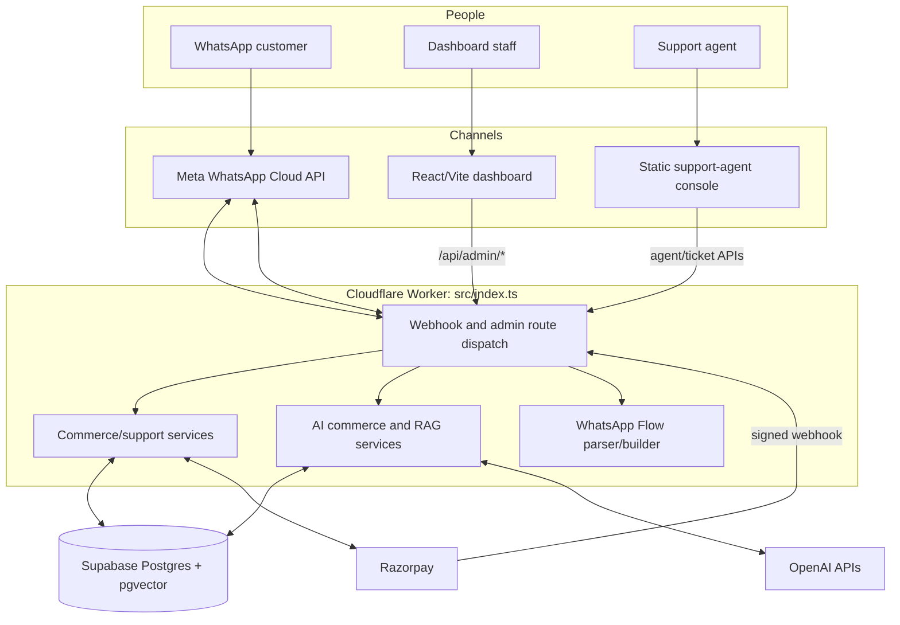
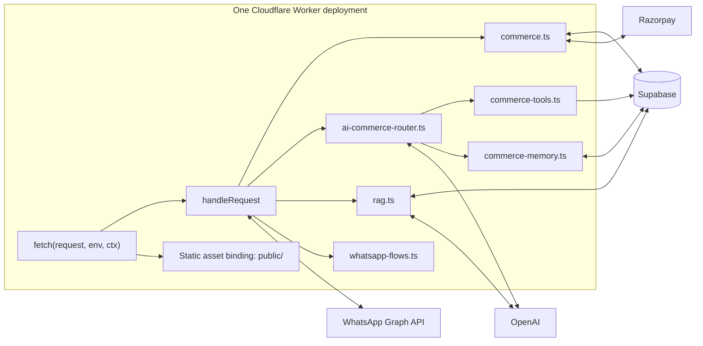
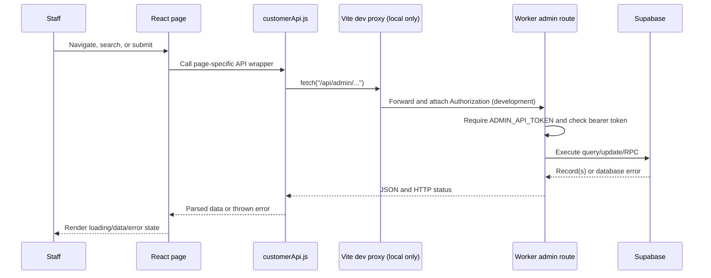
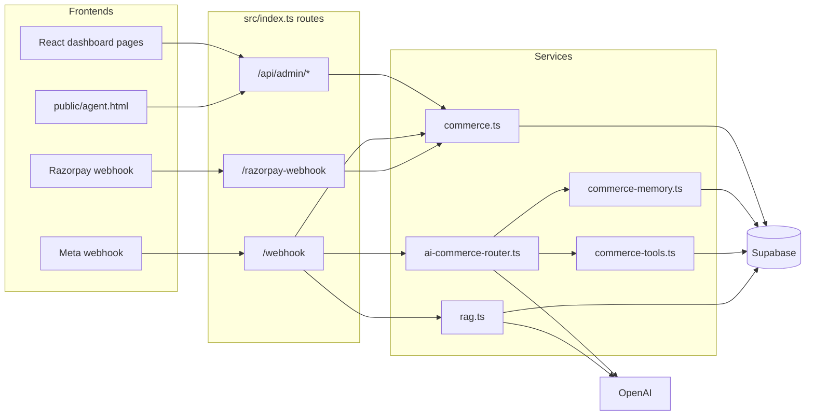
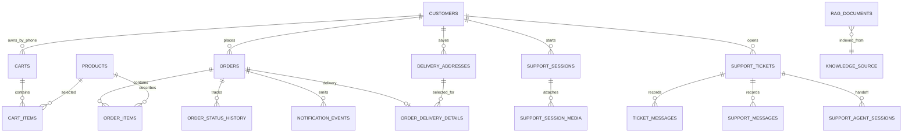
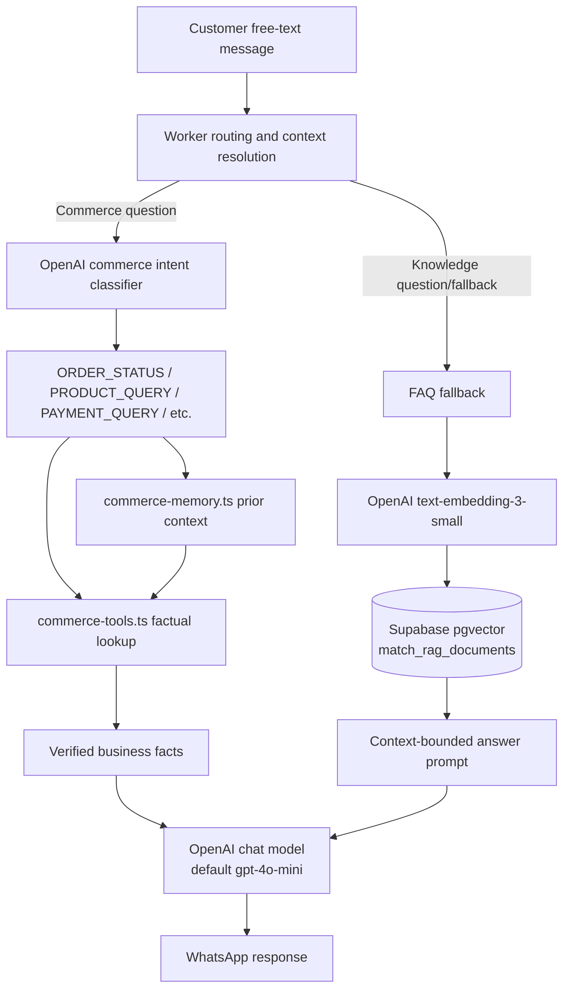
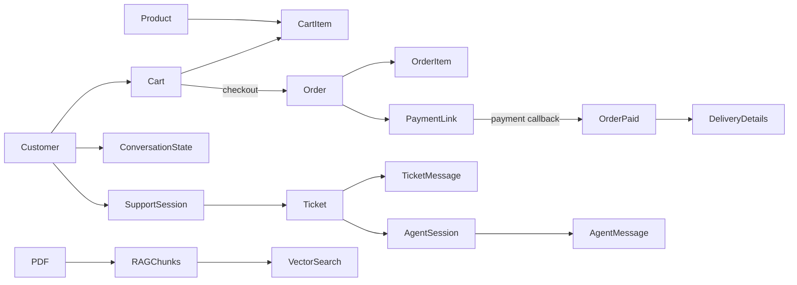
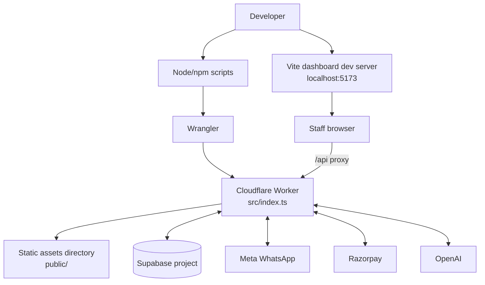

# Architecture Discovery Document

## Scope and evidence

This document reverse-engineers the architecture present in this repository. It describes active entry points, request/data flows, database schema, external services, and configuration based on source, migration, test, and build files. It does not prescribe a redesign.

The Worker route handler is large and lives primarily in [src/index.ts](../src/index.ts). The dashboard is a separate Vite application under [customer-care-dashboard](../customer-care-dashboard/). Database changes are represented by numbered SQL files in [supabase/migrations](../supabase/migrations/). Secrets are intentionally not reproduced here.

When sources disagree, this document distinguishes active runtime route dispatch from stale references in tests or handover documents. In particular, it does not treat the backup file [src/index.before-ai.ts.backup](../src/index.before-ai.ts.backup), sample file [src/P.js](../src/P.js), or old route descriptions as active runtime behavior.

## Executive summary

This is a small full-stack commerce/support system with two staff/customer interfaces and one backend runtime:

- **Backend runtime:** One Cloudflare Worker. `wrangler.jsonc` points to `src/index.ts` as its entry point. This handler receives WhatsApp and Razorpay webhooks and serves admin API routes.
- **Customer channel:** Meta WhatsApp Cloud API. The Worker parses messages, stores conversation state, reads/writes commerce and support records, optionally calls OpenAI, and sends replies.
- **Staff channel:** A React/Vite dashboard calls the Worker's `/api/admin/*` routes through a local Vite proxy. A separate static `public/agent.html` console uses agent-queue and messaging routes.
- **Persistence:** Supabase Postgres is shared across the bot and staff tools. The Worker creates Supabase clients using server-provided credentials.
- **Payments:** Razorpay payment links are created by the Worker; payment events return to a signed webhook and update order state.
- **AI:** OpenAI supports commerce intent classification, factual commerce response generation, embeddings, and FAQ generation. FAQ content is retrieved from Supabase pgvector. Cloudflare `AI` is configured and passed into RAG environment objects, but the inspected RAG implementation calls OpenAI endpoints; `/ai-test` is not proof of Workers AI model invocation.

The system is not split into independently deployed backend services. The Worker is an orchestration layer with service modules, and `src/index.ts` still contains significant business flow and route logic.

## Repository and application structure

| Area | Contents | Runtime significance |
|---|---|---|
| `src/` | Worker handler and TypeScript business/integration services | Active backend code; Worker entry is configured as `src/index.ts`. |
| `supabase/migrations/` | 17 ordered schema/function migrations | Defines the database contract expected by the Worker. |
| `customer-care-dashboard/` | React 19 + Vite dashboard | Separate frontend development/build project; proxies API requests in local development. |
| `public/` | Worker-served static assets, including `agent.html` and a small sample `index.html` | Static asset directory configured in Wrangler. |
| `whatsapp-flows/` | Meta WhatsApp Flow definition JSON | Source definition for the delivery-address Flow that is also published/configured with Meta. |
| `scripts/` | PDF ingestion command | Local CLI workflow; not a Worker request handler. |
| `test/`, `src/rag.spec.ts` | Vitest tests | Worker and service behavior tests using the Cloudflare Workers Vitest pool. |
| `docs/` | Handover and architecture documents | Human-maintained supporting material, not runtime configuration. |
| `Files/Backup_scripts/`, `src/index.before-ai.ts.backup` | Backup/sample utilities | Not referenced as Worker entry points by `wrangler.jsonc`. |

### Entry points and triggers

| Entry point | Trigger | Purpose and downstream dependencies |
|---|---|---|
| [src/index.ts](../src/index.ts), configured by [wrangler.jsonc](../wrangler.jsonc) | HTTP request to the Worker | Routes webhooks, admin APIs, and small utility routes. Uses Supabase, WhatsApp, OpenAI, Razorpay, and service modules. |
| `GET /webhook` in the Worker | Meta webhook subscription verification | Checks the subscription handshake and returns Meta's challenge. |
| `POST /webhook` in the Worker | Meta WhatsApp message or status callback | Parses inbound message/status data; schedules message processing using `ctx.waitUntil(...)`; talks to Supabase and WhatsApp, with OpenAI on selected paths. |
| `POST /razorpay-webhook` in the Worker | Razorpay payment event | Verifies the request signature and updates the related order through `commerce.ts`; may continue the delivery flow and notify the customer. |
| [customer-care-dashboard/src/main.jsx](../customer-care-dashboard/src/main.jsx) | Browser opens the dashboard | Mounts the React application; [App.jsx](../customer-care-dashboard/src/App.jsx) declares page routes. Pages call the shared API module. |
| [public/agent.html](../public/agent.html) | Staff navigates to the static agent console | Reads queue and ticket messages, accepts an agent session, sends replies, and ends sessions through admin endpoints. The token is entered by the operator. |
| [public/index.html](../public/index.html) | Browser opens Worker root static asset | Example page calls `GET /message` and `GET /random`; it is not the React dashboard. |
| [scripts/ingest-pdf.ts](../scripts/ingest-pdf.ts), via `npm run ingest` | Developer runs a local CLI command | Extracts PDFs, chunks text, creates embeddings through OpenAI, and writes `rag_documents` in Supabase. |
| Scheduled/background jobs | No scheduled Worker trigger found in `wrangler.jsonc` | No Cron Trigger or queue consumer is configured in the inspected deployment config. `ctx.waitUntil(...)` is request-attached background work, not a scheduled job. |

## System context and architecture layers



### Layer responsibilities

1. **User/channel layer:** WhatsApp for customers; the React dashboard and static agent console for staff.
2. **Transport/orchestration layer:** Cloudflare Worker request handler, which matches method/path, validates request/webhook data, starts processing, and constructs HTTP/WhatsApp responses.
3. **Application/service layer:** Commerce, support, intent-routing, RAG, and WhatsApp Flow helpers.
4. **Persistence layer:** Supabase Postgres tables and RPC functions. Conversation state is persisted rather than kept only in a Worker isolate.
5. **Provider layer:** Meta, OpenAI, Razorpay, and Cloudflare Worker platform APIs.

## Container and component architecture



`src/index.ts` is the primary integration point. `commerce.ts` and other modules are called functions within this deployment, not separately addressable microservices.

## Request-flow analysis

### WhatsApp inbound message

```mermaid
sequenceDiagram
    participant Customer
    participant Meta as WhatsApp Cloud API
    participant Worker as Cloudflare Worker
    participant State as Supabase conversation state
    participant Business as Commerce/support service
    participant AI as OpenAI (when required)
    Customer->>Meta: Text, button/list reply, image, or Flow submission
    Meta->>Worker: POST /webhook
    Worker->>Worker: Parse payload; inspect message/status event
    Worker-->>Meta: 200 EVENT_RECEIVED for message callback
    Worker->>Worker: Schedule message work using ctx.waitUntil
    Worker->>State: Load state/context and de-duplicate/resolve customer data as applicable
    Worker->>Business: Run menu, cart, order, delivery, or support branch
    opt AI-assisted intent or FAQ fallback
      Worker->>AI: Classify commerce/support intent, embed question, or generate response
      AI-->>Worker: Intent, vectors, or response text
      Worker->>State: Retrieve related facts/context from Supabase
    end
    Business-->>Worker: Business result
    Worker->>Meta: Send Cloud API reply or interactive message
    Meta-->>Customer: Deliver response
```

Observed behavior:

- The webhook extracts sender, Meta message ID, text, interactive button/list IDs, Flow submission JSON, and media fields from the first message in the payload.
- If no message exists, the handler treats the callback as a status-only event and acknowledges it.
- The message processing task is attached to the request via `ctx.waitUntil(...)`; success of the immediate HTTP acknowledgement does not guarantee that the later business operation or outbound WhatsApp call succeeded. Use Worker logs to troubleshoot the async work.
- Database conversation state and commerce memory allow follow-up messages to resolve an earlier product/order reference.
- Explicit menu, product/cart/checkout, order tracking, delivery, support ticket, and agent-flow handling occur before generic RAG fallback.

### Dashboard request



In the deployed frontend, the repository does not show a production reverse proxy/authentication deployment. The local Vite proxy is not an authentication system for deployed users.

### WhatsApp order creation and payment

```mermaid
sequenceDiagram
    participant Customer
    participant Meta
    participant Worker
    participant DB as Supabase
    participant RP as Razorpay
    Customer->>Meta: Checkout and provide/select delivery address
    Meta->>Worker: POST /webhook with button, Flow submission, or chat answer
    alt Published delivery Flow is configured and launch succeeds
      Worker->>Meta: Send interactive Flow with configured Flow ID
      Meta-->>Customer: Render delivery address form
      Customer->>Meta: Submit structured address fields
      Meta->>Worker: POST /webhook with Flow response_json
    else Flow ID is missing
      Worker->>DB: Save DELIVERY_DETAILS state at RECIPIENT_NAME
      Worker->>Meta: Ask for recipient/address fields one message at a time
      Customer->>Meta: Reply with address fields
      Meta->>Worker: POST /webhook for each answer
      Worker->>DB: Persist collection step and partial address in conversation_state
    end
    Worker->>DB: Validate/select or save delivery address
    Worker->>DB: createOrderFromCart: insert order and order_items; update cart
    Worker->>DB: Initialize/link order delivery data as applicable
    Worker->>RP: Create Payment Link API request
    RP-->>Worker: Payment link ID and URL
    Worker->>DB: Save payment-link values and payment_pending status
    Worker->>Meta: Send payment link to customer
    Customer->>RP: Complete payment
    RP->>Worker: POST /razorpay-webhook + signature
    Worker->>Worker: Verify HMAC signature and event
    Worker->>DB: Mark order paid, persist payment reference, update inventory/idempotency state
    Worker->>Meta: Confirm payment or ask/continue delivery-details flow
```

The WhatsApp checkout sequence consists of multiple provider/database operations and the handover states that it does not use a single transaction across all those operations. A partial failure can therefore leave intermediate state (for example an order without a usable payment link). The manual dashboard order path is different: it calls `create_admin_order()` in one Supabase database RPC, which writes the manual order, line item, and address-related aggregate within the function's transaction.

### Support ticket and human handoff

```mermaid
sequenceDiagram
    participant Customer
    participant Meta
    participant Worker
    participant DB as Supabase
    participant Agent as Agent console
    Customer->>Meta: Start support / describe issue
    Meta->>Worker: POST /webhook
    Worker->>DB: Create/update support session; collect issue context
    Worker->>DB: Create support_tickets row and message history
    Worker->>Meta: Send ticket acknowledgement and actions
    alt Current Connect Agent CTA
      Customer->>Meta: Tap CONNECT_AGENT
      Meta->>Worker: POST /webhook
      Worker->>DB: Optionally look up latest ticket for CTA context
      Worker->>Meta: Send wa.me direct-chat URL to configured support number
      Meta-->>Customer: Open a separate WhatsApp chat
    else Existing bot-mediated agent session
      Agent->>Worker: GET /api/admin/agent-queue
      Worker->>DB: Read waiting sessions, ticket and messages
      Agent->>Worker: POST /api/admin/agent-sessions/{id}/accept
      Worker->>DB: Assign agent; set ticket IN_PROGRESS
      Agent->>Worker: POST /api/admin/agent-sessions/{id}/reply
      Worker->>Meta: Send agent reply to customer
      Worker->>DB: Store support message
      Agent->>Worker: POST /api/admin/agent-sessions/{id}/end
      Worker->>DB: Close session and ticket; notify customer
    end
```

The active `CONNECT_AGENT` button handler sends a direct WhatsApp URL to the support number; it does not invoke `startAgentHandoff()` to create a queued bot-mediated session. The agent queue/session APIs and support session primitives remain present, and tests cover their lifecycle. Treat the direct-chat CTA and queued session flow as distinct paths.

## Backend service architecture

| Service/module | Responsibilities | Inputs/outputs | Dependencies and consumers |
|---|---|---|---|
| [src/index.ts](../src/index.ts) | Worker transport, route dispatch, webhook payload parsing, WhatsApp message construction, orchestration, CORS, error responses, and some workflow logic. | HTTP Request + `Env` + `ExecutionContext` → Response; webhook messages → provider replies and persisted effects. | Called by Cloudflare runtime; calls `commerce.ts`, `rag.ts`, `ai-commerce-router.ts`, `whatsapp-flows.ts`, Supabase, Meta, Razorpay, and OpenAI. |
| [src/commerce.ts](../src/commerce.ts) | Shared commerce/support persistence and business rules: customers, carts, orders, status transitions/history, delivery, support tickets/sessions/messages, payment links/webhooks, stock updates, and conversation state. | Typed domain inputs/records → persisted rows or domain outcomes. | Supabase service-role client; Razorpay; RAG helper for legacy/FAQ wrapper. Called mainly by `index.ts`, plus tests and AI-related helpers. |
| [src/ai-commerce-router.ts](../src/ai-commerce-router.ts) | Classify free-text commerce requests, resolve order/product references, retrieve facts through tools, and form an answer. | Customer text and conversation environment → intent classification, tool executions/facts, response. | OpenAI Chat Completions, `commerce-tools.ts`, `commerce-memory.ts`; called from `index.ts`. |
| [src/commerce-tools.ts](../src/commerce-tools.ts) | Read-only factual lookups for order status/history, product details/inventory, payment details, and invoices. | Phone/order/product identifiers → found/not-found result plus commerce facts. | Supabase via commerce client; consumed by AI router. |
| [src/commerce-memory.ts](../src/commerce-memory.ts) | Persist/read customer profile and conversation context; resolve omitted order/product references from prior turns. | Phone, classified intent, explicit IDs/names → stored context/profile or resolved references. | Supabase `conversation_context`, `customer_profiles`, `orders`, `order_items`, `products`; used by AI router and Worker. |
| [src/rag.ts](../src/rag.ts) | Text chunking, OpenAI embeddings, Supabase pgvector retrieval, prompt/context assembly, and FAQ answer generation. | PDF chunks or user question → vectors/context/answer. | OpenAI Embeddings and Chat Completions; Supabase `rag_documents` and `match_rag_documents()`. Called by `index.ts` and ingestion script. |
| [src/whatsapp-flows.ts](../src/whatsapp-flows.ts) | Format delivery-address Flow messages, parse Flow submissions, and manage per-field chat fallback validation. | Flow ID and Flow/chat answers → validated delivery-address input and next collection step. | Consumed by WhatsApp route logic in `index.ts`; Flow definition source is [whatsapp-flows/delivery-address-flow.json](../whatsapp-flows/delivery-address-flow.json). |
| [scripts/ingest-pdf.ts](../scripts/ingest-pdf.ts) | Local/document ingestion: read PDF(s), extract text, chunk, embed, and replace rows for a source. | CLI PDF file/folder and environment → Supabase vector rows. | `pdf-parse`, `rag.ts`, Supabase service role, OpenAI. |

### API dependency map



## API architecture

Admin paths below are the routes dispatched in the active [src/index.ts](../src/index.ts). The common admin check compares the incoming `Authorization` header to the configured bearer-token form of `ADMIN_API_TOKEN`. The endpoint list focuses on route, purpose, service/data access, and consumer; response shapes are summarized because nested row fields follow the database schema.

### Customer APIs

| Method and route | Purpose and request | Service/data | Consumer |
|---|---|---|---|
| `GET /api/admin/customers` | List customers with order count/latest order summary. | Direct Supabase reads: `customers`, `orders`. | Dashboard Customers, Dashboard, Orders, Conversations. |
| `POST /api/admin/customers` | Create customer; JSON includes `customer_name`, `whatsapp_number`, optional `email`. | Direct Supabase write: `customers`; normalizes/duplicate-checks phone. | Dashboard Customers. |
| `GET /api/admin/customers/{customerId}` | Read customer. | Direct Supabase read: `customers`. | Customer Details, Edit Customer. |
| `PATCH /api/admin/customers/{customerId}` | Update a limited set of customer fields. | Direct Supabase update: `customers`. | Edit Customer. |
| `GET /api/admin/customers/{customerId}/history` | Aggregate customer commerce, support, notification, and conversation history. | `customers`, `orders`, `order_items`, `order_status_history`, `order_delivery_details`, `delivery_addresses`, `support_tickets`, `support_sessions`, `ticket_messages`, `support_messages`, `notification_events`, `conversation_state`, `conversation_context`. | Customer Details. |
| `GET /api/admin/customers/{customerId}/orders` | List orders belonging to a customer ID. | Direct Supabase read: `orders`. | API wrapper exists; customer detail history is the page's main history source. |
| `POST /api/admin/customers/{customerId}/orders` | Create manual order; JSON requires product, quantity, unit price, delivery address; optional notes/status. | Supabase RPC `create_admin_order()`: customer/product validation and order aggregate writes. | Customer Details. |

### Order APIs

| Method and route | Purpose and request | Service/data | Consumer |
|---|---|---|---|
| `GET /api/admin/orders` | List orders with items, customer summary, and status history. | Direct Supabase reads: `orders`, `order_items`, `customers`, `order_status_history`. | Dashboard, Orders, Order Details, Tracking, Conversations. |
| `POST /api/admin/orders/{orderId}/status` | Change order status; JSON `status`, optional reason and actor fields. | `commerce.ts` transition validation/update/history; `notification_events`; outbound WhatsApp on status change. | Tracking. |
| `POST /api/admin/orders/{orderId}/delivery-status` | Change delivery status; JSON `status`. | `commerce.ts`; `order_delivery_details`; may be used by admin clients. | No direct React wrapper identified. |

### Product, cart, conversation, address APIs

| Method and route | Purpose and request | Service/data | Consumer |
|---|---|---|---|
| `GET /api/admin/products` | List product catalog. | Direct Supabase read: `products`. | Products, Customer Details (manual order product selector). |
| `PATCH /api/admin/products/{productId}` | Update name, price, description, stock, or active state. | Direct Supabase update: `products`. | Products. |
| `GET /api/admin/carts` | List carts with their cart items. | Direct Supabase reads: `carts`, `cart_items`. | Carts, Cart Details, Conversations. |
| `GET /api/admin/conversations` | Return recent conversation context and state rows. | Direct Supabase reads: `conversation_context`, `conversation_state`. | Conversations. |
| `GET /api/admin/customers/{customerId}/addresses` | List a customer's active addresses. | Direct Supabase read: `delivery_addresses`. | Edit Customer, Customer Details. |
| `POST /api/admin/customers/{customerId}/addresses` | Create address; required profile/recipient/address/city/state/six-digit PIN fields. | Direct Supabase reads/writes: `customers`, `delivery_addresses`. | Edit Customer. |
| `PATCH /api/admin/customers/{customerId}/addresses/{addressId}/default` | Set selected active address as default for that customer. | Direct Supabase updates: `delivery_addresses`. | Edit Customer. |

### Support and agent APIs

| Method and route | Purpose and request | Service/data | Consumer |
|---|---|---|---|
| `GET /api/admin/tickets` | List tickets. | `commerce.ts`/Supabase: `support_tickets`. | Admin clients. |
| `GET /api/admin/tickets/{ticketId}` | Read ticket summary. | `commerce.ts`: `getSupportTicket()`, table `support_tickets`. | Admin clients. |
| `PATCH /api/admin/tickets/{ticketId}/status` | Change ticket status; notifies customer on status change. | `commerce.ts`, `support_tickets`, notifications, WhatsApp. | Admin clients. |
| `GET /api/admin/tickets/{ticketId}/messages` | Read combined text and image message history. | `commerce.ts`, `support_messages`, `ticket_messages`. | Static agent console/chat client. |
| `POST /api/admin/tickets/{ticketId}/messages` | Store agent reply and send it to the customer through WhatsApp. | `commerce.ts`, `support_messages`, WhatsApp Graph API. | Static agent console. |
| `POST /api/admin/tickets/{ticketId}/reply` | Alternate ticket reply route; sends and records the reply. | `commerce.ts`, `support_messages`, WhatsApp Graph API. | Admin clients. |
| `GET /api/admin/agent-queue` | Return waiting sessions with ticket context, recent messages, and images. | `commerce.ts`, `support_agent_sessions`, `support_tickets`, `support_messages`, `ticket_messages`. | Static agent console. |
| `POST /api/admin/agent-sessions/{sessionId}/accept` | Assign a waiting session; JSON `agentId`. | `commerce.ts`, `support_agent_sessions`, `support_tickets`. | Static agent console. |
| `POST /api/admin/agent-sessions/{sessionId}/reply` | Send assigned-agent response; JSON `agentId`, `message`. | Session ownership check, `support_messages`, WhatsApp. | Static agent console. |
| `POST /api/admin/agent-sessions/{sessionId}/end` | Close active session and ticket; JSON `agentId`. | `commerce.ts`, `support_agent_sessions`, `support_tickets`, WhatsApp. | Static agent console. |

### Webhooks, utility routes, and contract drift

| Method and route | Purpose | Auth/notes |
|---|---|---|
| `GET /webhook` | Meta verification handshake. | Verification token currently comes from a constant in `src/index.ts`. |
| `POST /webhook` | WhatsApp inbound messages and statuses. | Message work runs under `ctx.waitUntil(...)`; see signature caveat in Authentication Architecture. |
| `POST /razorpay-webhook` | Razorpay payment events. | HMAC signature is verified using the raw body and configured webhook secret. |
| `GET /message` | Returns a greeting text; static sample page calls it. | Utility route; not an admin API. |
| `GET /random` | Returns a UUID; static sample page calls it. | Utility route; not an admin API. |
| `GET /ai-test` | Runs the FAQ/RAG answer path for a query. | Utility/testing route; requires RAG/OpenAI/Supabase configuration. |

**Route drift found during source analysis:** `test/admin-customer-orders.spec.ts` and older handover material describe `GET /api/admin/orders/customer/phone/{phone}` and `GET /api/admin/orders/{orderId}`. Those paths were not found in the active `src/index.ts` route dispatch. Similarly, `customerApi.js` exports `replaceCustomerAddress()` for `PATCH /api/admin/customers/{customerId}/addresses/{addressId}`, but the Worker has no matching handler. These should be treated as stale/intended contracts until code and tests agree.

The customer detail `PATCH` handler allows `name`, `email`, and `phone`, while the base customer schema uses `whatsapp_number` rather than `phone`; the current Edit Customer page sends name/email only. Do not assume the `phone` field is safely mapped.

## Database architecture

Supabase Postgres is the shared persistence boundary. Worker service functions mostly create the Supabase client with `SUPABASE_SERVICE_ROLE_KEY`; a separate public/anon client exists for product browsing paths. Consequently, row-level policies are not a per-user authorization layer for service-role calls.

### Entity inventory and business data model

| Domain | Tables | Main relationships/purpose |
|---|---|---|
| Customer and catalog | `customers`, `products` | A customer is associated with orders, saved addresses, and support records. Product records supply catalog/stock facts. |
| Cart and order | `carts`, `cart_items`, `orders`, `order_items` | Cart contains items, each referencing a product; checkout creates orders and order items. Orders reference customers optionally and retain customer phone. |
| Order lifecycle | `order_status_history`, `notification_events` | Status history records order transitions; notification rows track queued/sent/failed and related order/ticket events. |
| Delivery | `delivery_addresses`, `order_delivery_details` | Saved addresses belong to a customer; an order has a unique delivery-details row and may reference a saved address. |
| Conversation | `conversation_state`, `conversation_context`, `customer_profiles`, `processed_webhook_events` | State is keyed to WhatsApp number; context stores last product/order/intent; profile stores commerce/customer facts; processed event table supports webhook bookkeeping. |
| Support | `support_sessions`, `support_session_media`, `support_tickets`, `ticket_messages`, `support_messages`, `support_agent_sessions` | Session gathers issue details; ticket tracks issue/status; message tables store customer/agent text and media metadata; agent session manages queue/assignment. |
| Knowledge | `knowledge_base`, `rag_documents` | Legacy keyword knowledge table remains; active FAQ RAG uses `rag_documents` and pgvector matching RPC. |



`KNOWLEDGE_SOURCE` in this diagram is conceptual PDF/source metadata, not a separate table. The diagram is intentionally simplified: some links are nullable or implicit by phone number, and actual optionality/constraints are in SQL.

### Migration sequence and database routines

| Migration | Architectural change |
|---|---|
| `001_commerce_schema.sql` | Base customers/products/carts/cart_items/orders/order_items/knowledge_base/conversation_state/processed_webhook_events tables, RLS, service-role policies, and `touch_updated_at()` trigger function. |
| `002_fix_orders_schema.sql` | Adjusts existing orders columns/constraints for the active order representation. |
| `003_rag_pgvector.sql` | Enables pgvector; creates `rag_documents`, HNSW/source indexes, and `match_rag_documents()` similarity-search RPC. |
| `004_order_status_history.sql` | Adds order status audit history. |
| `005_notification_events.sql` | Adds notification-event tracking and updated-at trigger. |
| `006_status_constraint_updates.sql` | Expands order status constraints for fulfillment statuses. |
| `007_support_tickets.sql`, `008_ticket_messages.sql`, `009_ticket_message_media.sql` | Adds support tickets, messages, and message media metadata. |
| `010_support_sessions.sql`, `011_support_session_media.sql` | Adds conversational support intake sessions and media metadata. |
| `012_support_agent_chat.sql`, `014_support_agent_sessions.sql` | Adds agent/customer message history and agent queue/session records; extends ticket fields/status support. |
| `013_commerce_memory.sql` | Adds conversation context and customer profile memory. |
| `015_delivery_addresses.sql` | Adds saved customer addresses and per-order delivery details; updates allowed conversation states. |
| `016_admin_crm_orders.sql`, `017_fix_manual_order_delivery_address.sql` | Add/update `create_admin_order()` for manual dashboard order creation. |

### Constraints, indexes, RLS, and functions

- Migrations create indexes for common customer phone, order chronology/status, ticket status/customer/order, support messages/media, delivery status/address, context/profile, and vector retrieval queries.
- RLS is enabled on core and later domain tables. The migration policies primarily grant all operations to the `service_role`; most Worker database functions use that role.
- `match_rag_documents(query_embedding, match_count, match_threshold)` computes cosine similarity against the 1536-dimensional embedding column and returns qualifying document chunks.
- `create_admin_order(...)` validates customer/product/quantity/price/address/status and writes the manual order aggregate through one RPC invocation.
- `touch_updated_at()` and `touch_notification_event_updated_at()` provide update timestamp triggers; delivery migrations attach timestamp triggers to delivery tables.
- Payment/order logic includes service-layer idempotency checks and duplicate-payment protection. `processed_webhook_events` exists in the base schema; inspect the specific path before assuming every provider callback uses that table.
- The handover identifies a schema compatibility risk around legacy order fields versus later order schema. Verify real Supabase schema before relying on old order representations.

## Authentication architecture

### Admin APIs

- `ADMIN_API_TOKEN` is configured as a Worker environment binding and checked by `isAdminRequest()` in `src/index.ts`.
- Admin routes return `503` when token configuration is missing and `401` when the `Authorization` header fails the expected bearer-token comparison.
- This is a shared static token, not per-user login, identity, role-based access, or a token-rotation/session system.

### Dashboard and agent clients

- Local React dashboard development: `customer-care-dashboard/vite.config.js` requires `ADMIN_API_TOKEN` from local `.env.local` and adds the Authorization header in the Vite proxy. `customerApi.js` itself does not attach it.
- Static agent console: `public/agent.html` requests an admin token and agent ID from the user and stores them in browser `localStorage`. This is a browser-held shared secret and is less protected than a server-side proxy.
- The repository does not contain a production dashboard hosting/reverse-proxy definition. Production deployment must ensure the admin credential is not bundled into public JavaScript.

### Provider webhook verification

- **Meta GET handshake:** `/webhook` compares `hub.verify_token` to a hard-coded source constant and returns the challenge when mode/token/challenge match. This value should be externalized and rotated before production reliance.
- **Meta POST callback:** The handler verifies `X-Hub-Signature-256` with `WHATSAPP_APP_SECRET` for delivery-status callbacks. The current handler does not apply the same check to ordinary inbound message payloads; this is a security concern to review.
- **Razorpay:** `/razorpay-webhook` validates HMAC over the raw body with `RAZORPAY_WEBHOOK_SECRET` and the incoming `x-razorpay-signature`.
- **Supabase:** Service-role credentials give privileged database access and bypass ordinary RLS restrictions. They must remain server-side.

### CORS and trust boundaries

The Worker currently allows the local origin `http://localhost:5173` in its CORS response handling. CORS is not authentication. Admin authorization is still required, and the production dashboard's origin/proxy behavior is not described by local Vite settings.

## AI architecture



### AI workflows

- **Commerce intent classification:** `ai-commerce-router.ts` asks OpenAI for structured intents (order status/history, product, inventory, payment, invoice, delivery, cancellation, return/refund, or unknown). It does not itself treat the model as the source of commerce truth.
- **Commerce routing:** `retrieveCommerceFacts()` calls deterministic Supabase-backed tools. Conversation memory resolves missing product/order references; answer generation is based on returned facts and intent.
- **Support intent classification:** `index.ts` also has a support intent classifier for continue/close-ticket decisions; its direct OpenAI call is distinct from commerce classification.
- **FAQ/RAG:** `rag.ts` chunks documents (default 1000 characters with overlap), embeds chunks/questions using OpenAI, calls Supabase `match_rag_documents()`, and supplies the returned context to an OpenAI answer prompt. The system prompt instructs it to avoid unsupported claims and return a fixed low-confidence response when retrieval fails/is empty.
- **Ingestion:** `scripts/ingest-pdf.ts` runs outside the Worker. It extracts PDF text with `pdf-parse`, chunks and embeds it, and stores chunks in `rag_documents`.
- **Model/config:** `OPENAI_CHAT_MODEL` optionally overrides the chat model; code defaults relevant chat paths to `gpt-4o-mini`. `RAG_MATCH_THRESHOLD` controls pgvector matching. The embeddings code uses `text-embedding-3-small`.
- **Cloudflare Workers AI:** `AI` is declared as a Wrangler binding and included in RAG environment types, but the inspected embeddings/chat/retrieval implementation uses OpenAI plus Supabase. Do not represent Workers AI as the production FAQ model path without further runtime evidence.

## External integration architecture

| Provider | Incoming path/data | Outgoing path/data | Auth/config | Failure behavior and source |
|---|---|---|---|---|
| Supabase | Query results and RPC results to Worker | Database REST/PostgREST operations for customers, products, carts, orders, delivery, support, memory, and vector RPC | URL + anon or service-role key; Worker uses service role for privileged paths | Service helpers inspect Supabase errors and generally throw; handlers map failures to JSON/HTTP errors. [src/commerce.ts](../src/commerce.ts), [src/index.ts](../src/index.ts), [src/rag.ts](../src/rag.ts). |
| Meta WhatsApp Cloud API | `GET /webhook` handshake; `POST /webhook` messages, statuses, Flow responses | Graph API `/messages` with text/interactive/Flow/CTA payloads | `WHATSAPP_TOKEN`, `PHONE_NUMBER_ID`, optional `WHATSAPP_APP_SECRET`, optional `WHATSAPP_DELIVERY_FLOW_ID` | Missing delivery Flow ID falls back to chat-based address collection; a configured Flow launch failure does not fall back. Other outbound non-2xx responses throw. Webhook parsing failures return 400; async downstream errors are logged. [src/index.ts](../src/index.ts). |
| OpenAI | None (Worker-initiated integration) | Chat Completions for intent/answer generation; Embeddings API for RAG | `OPENAI_API_KEY`, optional chat model | Non-OK responses throw in commerce router; RAG catches selected retrieval/generation failures and returns no-confidence behavior. [src/ai-commerce-router.ts](../src/ai-commerce-router.ts), [src/rag.ts](../src/rag.ts). |
| Razorpay | `POST /razorpay-webhook` payment event | Payment Links API | Key ID/secret for API Basic Auth; webhook secret for HMAC verification | Missing payment-link credentials are detected before calling Razorpay; after an order/address are saved, the customer receives an order-specific support message instead of a generic checkout failure. Invalid webhook signatures are rejected; duplicate paid state is guarded. [src/commerce.ts](../src/commerce.ts), [src/index.ts](../src/index.ts). |
| Cloudflare | Worker HTTP requests and static asset requests | Worker responses and `ctx.waitUntil` task scheduling | Wrangler deployment configuration; binding `AI` | Observability is enabled in Wrangler; no Cron/Queue/Durable Object binding was found in the deployment config. [wrangler.jsonc](../wrangler.jsonc). |

## Database ER and business lifecycle summaries



The record model is hybrid: some joins use numeric `customer_id`/`order_id`, while conversation/carts/support often also identify the customer by WhatsApp phone. Check both identifiers when tracing a history or association; the admin customer-history endpoint explicitly merges orders by customer ID and phone.

## Deployment and runtime architecture



- `wrangler.jsonc` configures `src/index.ts`, compatibility date `2026-07-29`, `nodejs_compat` and `global_fetch_strictly_public` flags, static assets under `public/`, the `AI` binding, and observability/source maps.
- Root `package.json` scripts: `dev`/`start` run Wrangler locally; `deploy` runs `wrangler deploy`; `test` runs Vitest; `cf-typegen` generates Worker types; `ingest` runs the PDF script via `tsx`.
- `vitest.config.mts` uses `@cloudflare/vitest-pool-workers` with `wrangler.jsonc`, exercising Worker code in a Workers-compatible test pool.
- No `engines` requirement is declared in the root package manifest; it uses Node tooling for Wrangler, Vitest, and ingestion. The deployed runtime is Cloudflare Workers, not a long-lived Node server.
- Local dashboard configuration in `customer-care-dashboard/vite.config.js` proxies `/api` to `VITE_API_PROXY_TARGET` or `http://localhost:8787`; it requires a local admin token.
- No `.github/workflows` deployment workflow or production dashboard deployment configuration was found in the repository root during this review. Deployment permissions, environment promotion, and dashboard hosting therefore need to be sourced from the team's external operational setup.
- Supabase migrations are SQL files; the package scripts do not show an automated migration command. Database migration application is a separate operation and must target the same project as `SUPABASE_URL`.

### Environment and binding inventory

| Variable/binding | Consumer and role | Sensitivity/notes |
|---|---|---|
| `SUPABASE_URL` | Selects Supabase project for Worker and ingestion. | Configuration; identifies deployment target. |
| `SUPABASE_ANON_KEY` | Public Supabase client paths, including public catalog reads. | Public/anon key, but still configure correct RLS policies. |
| `SUPABASE_SERVICE_ROLE_KEY` | Privileged database operations in Worker and ingestion. | Secret; bypasses ordinary RLS restrictions. |
| `WHATSAPP_TOKEN` | Authorizes outbound Meta Graph API calls. | Secret. |
| `PHONE_NUMBER_ID` | Selects WhatsApp business phone endpoint. | Identifier/configuration. |
| `WHATSAPP_APP_SECRET` | Validates status webhook signature. | Secret; optional in type but required to accept status callback verification. |
| `WHATSAPP_DELIVERY_FLOW_ID` | Selects published WhatsApp address Flow. | Optional identifier; chat address collection is used only when this value is missing. |
| `RAZORPAY_KEY_ID` / `RAZORPAY_KEY_SECRET` | Authenticates Payment Links API calls. | Credentials; keep private. |
| `RAZORPAY_WEBHOOK_SECRET` | Validates Razorpay webhook HMAC. | Secret. |
| `OPENAI_API_KEY` | Commerce intent and answer calls, embeddings, RAG, ingestion. | Secret. |
| `OPENAI_CHAT_MODEL` | Optional chat model override. | Non-secret setting. |
| `RAG_MATCH_THRESHOLD` | Optional minimum similarity for FAQ retrieval. | Non-secret setting; code has a default. |
| `ADMIN_API_TOKEN` | Worker admin API auth; Vite proxy reads same value locally. | Secret; not a frontend `VITE_*` value. |
| `SUPPORT_WHATSAPP_NUMBER` | Destination for direct support CTA URL. | Phone number configuration; not a credential. |
| `AI` | Wrangler Workers AI binding passed into environment objects. | Cloudflare binding; inspected RAG uses OpenAI API directly. |
| `VITE_API_PROXY_TARGET` | Local Vite proxy target override. | Non-secret; defaults to local Wrangler URL. |

Local Worker variables are conventionally stored in `.dev.vars`; dashboard proxy settings in `customer-care-dashboard/.env.local`; PDF ingestion can load `.env` via `dotenv`. This guide records names and purposes only, not values.

## API-to-page map

| Frontend surface | Worker APIs commonly consumed |
|---|---|
| Dashboard overview (`/`) | `GET /api/admin/customers`, `GET /api/admin/orders` |
| Customers (`/customers`) | `GET/POST /api/admin/customers` |
| Customer details (`/customers/:customerId`) | customer details/history, customer orders, product list, manual order creation, address list |
| Edit customer (`/customers/:customerId/edit`) | customer read/update, address list/create/default |
| Orders (`/orders`) and Order Details (`/orders/:id`) | orders list and customer list; the detail page selects the order client-side from those lists |
| Tracking (`/tracking`) | orders list and order status update |
| Carts (`/carts`) and Cart Details (`/carts/:id`) | carts list with items |
| Conversations (`/conversations`) | conversations, customers, orders, carts |
| Products (`/products`) | product list/update |
| Static agent console (`/agent.html`) | agent queue, accept/reply/end session, ticket messages |

The React dashboard's navigation does not include dedicated ticket or agent-queue pages; support queue functionality is in the separate static agent console and/or API clients.

## Architecture findings and caveats

These are observed architecture facts and integration risks, not a standalone security assessment:

1. **Large orchestration module:** `src/index.ts` contains webhook handling, admin route logic, provider calls, and many workflow branches. The other service modules help organize behavior but do not replace the central handler.
2. **Split transaction boundaries:** WhatsApp checkout crosses multiple Supabase/API calls; the handover explicitly notes no transaction spans the checkout sequence. Manual CRM order creation uses one database RPC.
3. **Webhook verification asymmetry:** Razorpay signatures are verified. WhatsApp status callbacks are verified when an app secret is configured, but ordinary inbound messages do not use that same signature-validation path. The GET verify token is hard-coded.
4. **Shared admin secret:** Admin authorization is a single static token. The agent console stores it in localStorage. It is not per-user identity or role-based control.
5. **Mixed database access styles:** The Worker has both anon and service-role Supabase clients. Most privileged reads/writes use the service role; RLS policies do not constrain those calls as they would an anon/user client.
6. **Active-vs-documented route drift:** Two order detail/phone lookup routes in tests/handover and one address-update frontend helper do not match active Worker route dispatch. Verify the runtime route table before building new UI against them.
7. **Customer phone field mismatch:** The customer PATCH handler's `phone` allowlist does not correspond directly to the base schema's `whatsapp_number` column; the current UI only patches name/email.
8. **Separate integration destinations:** The `CONNECT_AGENT` action currently creates a direct `wa.me` CTA, while bot-mediated agent queue APIs and session lifecycle are separate capabilities.
9. **AI platform ambiguity:** Wrangler declares Workers AI, but current RAG and commerce AI calls use OpenAI HTTP APIs. `/ai-test` calls the RAG wrapper, not `env.AI.run`.
10. **Deployment operations outside repository:** No CI workflow or dashboard production hosting config was found; do not infer automated deployment/migration order from the local npm scripts.

## Recommended architecture reading order

1. [wrangler.jsonc](../wrangler.jsonc) and [src/index.ts](../src/index.ts): runtime boundary, request routing, and environment bindings.
2. [src/commerce.ts](../src/commerce.ts): database-backed order, support, delivery, and payment rules.
3. [src/ai-commerce-router.ts](../src/ai-commerce-router.ts), [src/commerce-tools.ts](../src/commerce-tools.ts), and [src/commerce-memory.ts](../src/commerce-memory.ts): AI commerce path and its factual sources.
4. [src/rag.ts](../src/rag.ts), [scripts/ingest-pdf.ts](../scripts/ingest-pdf.ts), and [003_rag_pgvector.sql](../supabase/migrations/003_rag_pgvector.sql): knowledge ingestion/retrieval.
5. Relevant numbered migrations and tests under [test](../test/) before changing a schema or business workflow.
6. [customer-care-dashboard/src/App.jsx](../customer-care-dashboard/src/App.jsx), [customerApi.js](../customer-care-dashboard/src/api/customerApi.js), and [public/agent.html](../public/agent.html) when changing staff-facing APIs.

## Architecture diagrams index

This document includes:

1. System context and architecture layers.
2. Worker container/component diagram.
3. WhatsApp inbound request sequence.
4. Dashboard API request sequence.
5. Order creation/payment sequence.
6. Support ticket and handoff sequence.
7. API/service dependency map.
8. Simplified database ER diagram and business lifecycle graph.
9. AI/RAG flow.
10. Deployment/runtime diagram.

Use the diagrams as source material for architecture presentations. They reflect the repository configuration and source reviewed; provider console settings, deployed Cloudflare secrets, production proxying, and the live Supabase schema are external facts and should be confirmed with the owning operations team before treating them as deployment truth.
