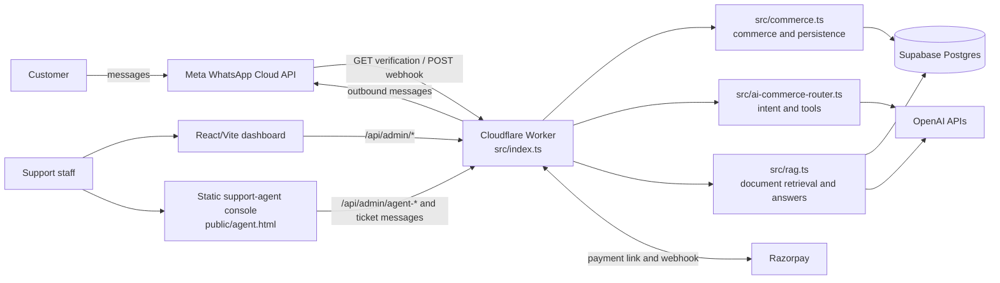
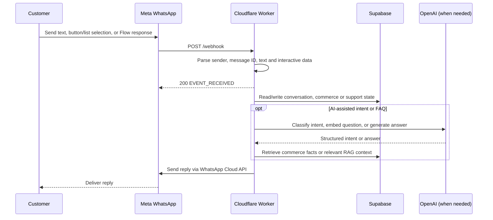
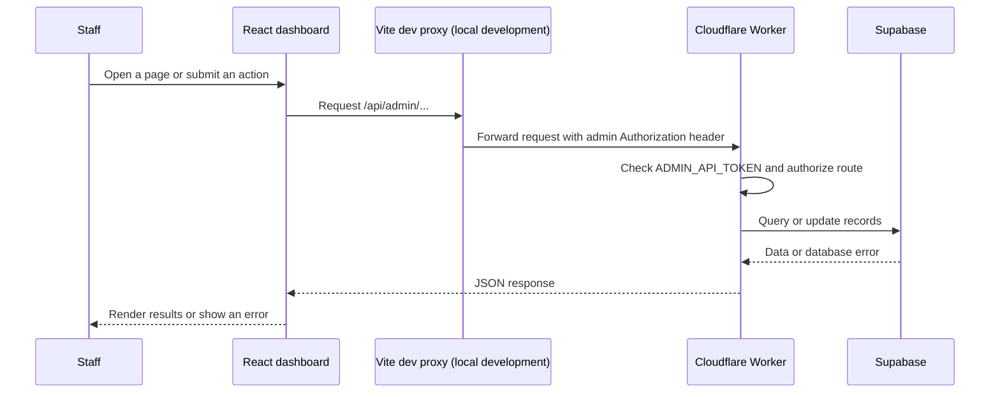
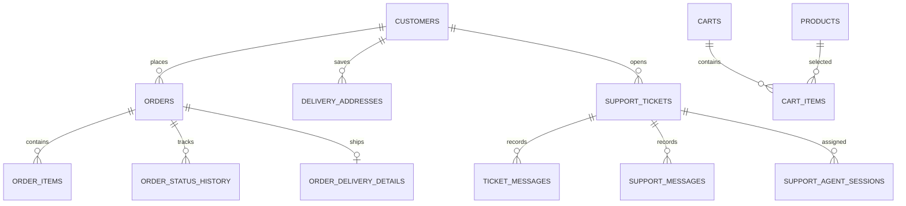

# Backend Overview

This guide describes the backend behavior currently implemented in this repository. It is intended as a first read for a developer who needs to understand the system and make a small change safely; it is not a line-by-line code reference.

## Purpose and main features

The backend is a TypeScript Cloudflare Worker that supports a WhatsApp commerce and customer-support bot. It coordinates:

- WhatsApp product browsing, carts, checkout, order tracking, delivery details, and support conversations.
- Admin APIs used by the React customer-care dashboard.
- Supabase reads and writes for commerce, customer, conversation, and support data.
- Razorpay payment links and payment webhooks.
- OpenAI-assisted commerce intent classification and FAQ responses grounded in documents stored in Supabase pgvector.

The dashboard is a separate React/Vite application, but its API requests are served by this same Worker. Supabase is the shared source of truth for both WhatsApp and dashboard workflows.

## Architecture



### Technologies and responsibilities

| Component | Role |
|---|---|
| Cloudflare Workers | Runs the API and WhatsApp webhook handler without a separately managed application server. Wrangler config is in [wrangler.jsonc](../wrangler.jsonc). |
| Supabase/Postgres | Stores customers, products, carts, orders, delivery data, conversations, support tickets, agent messages, and RAG documents. The schema is built by [supabase/migrations](../supabase/migrations/). |
| Meta WhatsApp Cloud API | Delivers incoming customer messages and receives bot replies. The Worker makes outbound Graph API requests. |
| OpenAI | Classifies commerce intents, creates embeddings, and generates FAQ answers using retrieved document context. |
| Razorpay | Creates customer payment links and sends payment events to the Worker. |
| React/Vite dashboard | Provides staff-facing customer, order, cart, product, conversation, and tracking views. It lives in [customer-care-dashboard](../customer-care-dashboard/). |
| Static agent console | The separately served [public/agent.html](../public/agent.html) handles the waiting support queue, agent assignment, replies, and session ending. |
| Cloudflare Workers AI binding | Configured as `AI` in Wrangler. The current documented RAG flow uses OpenAI directly; do not assume the binding is used for FAQ answers. |

## Request lifecycle

### 1. WhatsApp message



The Worker schedules inbound message processing using `ctx.waitUntil(...)`; the webhook acknowledgement can therefore arrive before the database work and reply finish. A customer’s conversation state helps route multi-step shopping, checkout, delivery, and support interactions.

### 2. Dashboard API call



The React frontend API functions are in [customerApi.js](../customer-care-dashboard/src/api/customerApi.js). In local development, [vite.config.js](../customer-care-dashboard/vite.config.js) proxies `/api` to `http://localhost:8787` by default and adds the configured admin header on the proxy request. The browser-side API helper itself does not add that token. The separate static support-agent console in [public/agent.html](../public/agent.html) calls the same Worker APIs directly and asks the agent for the admin token and agent ID.

### 3. Order creation

For WhatsApp checkout, the Worker calls `createOrderFromCart()` in [src/commerce.ts](../src/commerce.ts). It creates an order and order items from the customer’s cart, then marks the cart checked out. The Worker then creates a Razorpay payment link, saves the link and payment-pending state, and sends the link to the customer.

For a staff-created order, `POST /api/admin/customers/{customerId}/orders` validates the request and calls the Supabase `create_admin_order()` RPC. Migrations [016_admin_crm_orders.sql](../supabase/migrations/016_admin_crm_orders.sql) and [017_fix_manual_order_delivery_address.sql](../supabase/migrations/017_fix_manual_order_delivery_address.sql) define/update this database function.

### 4. Payment

The Worker posts to Razorpay to create the payment link. Razorpay later calls `POST /razorpay-webhook`. The handler passes the raw request body and `x-razorpay-signature` to `handleRazorpaySuccessWebhook()` in [src/commerce.ts](../src/commerce.ts). The service validates the signature using `RAZORPAY_WEBHOOK_SECRET`, processes the paid event, updates the order (and inventory where applicable), and avoids double-processing already-paid orders. On success, the Worker may continue the delivery-details conversation or notify the customer.

### 5. Support ticket

The customer enters the support flow in WhatsApp. The Worker collects issue details, potentially through a support session, and calls support service functions in [src/commerce.ts](../src/commerce.ts) to create a ticket. Customer messages and supported image metadata are recorded against the ticket. Staff can inspect and update tickets using `/api/admin/tickets/*` or work from the agent queue using `/api/admin/agent-queue` and `/api/admin/agent-sessions/*`. Agent replies are sent to the customer through WhatsApp and stored in the support message history.

## API reference

All `/api/admin/*` routes are intended for staff and require the configured admin authorization header. JSON response examples below show the top-level shape; individual records contain additional fields.

### Customers

| Method and endpoint | Purpose | Request | Response |
|---|---|---|---|
| `GET /api/admin/customers` | List customers with order-count/latest-order summary. | None | `{ success, count, customers }` |
| `POST /api/admin/customers` | Create a customer. | JSON: `customer_name`, `whatsapp_number`, optional `email` | `201 { success, customer }` |
| `GET /api/admin/customers/{customerId}` | Read a customer. | None | `{ success, customer }` |
| `PATCH /api/admin/customers/{customerId}` | Update customer details. | JSON fields accepted by the current handler: `name`, `email`, `phone` | `{ success, customer }` on success |
| `GET /api/admin/customers/{customerId}/history` | Load customer orders, support data, notifications, and conversation context/state. | None | `{ success, history }` |
| `GET /api/admin/customers/{customerId}/orders` | List that customer’s orders. | None | `{ success, count, orders }` |
| `POST /api/admin/customers/{customerId}/orders` | Create a manual order with a delivery address. | JSON includes `product_id`, `quantity`, `unit_price`, `delivery_address`; optional `notes`, `initial_status` | `201 { success, order, item, delivery_address }` |

**Customer update note:** The handler permits `name`, `email`, and `phone` fields but forwards these names to the `customers` table. The base migration defines `whatsapp_number`, not `phone`. The current React edit form sends only `name` and `email`; avoid sending `phone` until the API maps it to the database field and that behavior has been tested.

### Delivery addresses

| Method and endpoint | Purpose | Request | Response |
|---|---|---|---|
| `GET /api/admin/customers/{customerId}/addresses` | List active addresses, default first. | None | `{ success, count, addresses }` |
| `POST /api/admin/customers/{customerId}/addresses` | Add an address. | JSON requires `profile_name`, `recipient_name`, `recipient_phone`, `address_line_1`, `city`, `state`, `pincode`; other address fields are optional | `201 { success, address }` |
| `PATCH /api/admin/customers/{customerId}/addresses/{addressId}/default` | Set the customer’s active default address. | None | `{ success, address }` or `{ success, addressId }` |

**Implementation gap:** The dashboard API helper defines `PATCH /api/admin/customers/{customerId}/addresses/{addressId}` for replacing address fields, but there is no matching handler in the current `src/index.ts`. The current Edit Customer page uses list/create/default operations, not this replace helper. Do not rely on the replace call until the backend route is implemented and tested.

### Orders and tracking

| Method and endpoint | Purpose | Request | Response |
|---|---|---|---|
| `GET /api/admin/orders` | List orders, including associated customer and order items. | None | `{ success, count, orders }` |
| `POST /api/admin/orders/{orderId}/status` | Change order status; uses service transition rules, records history, and triggers notification handling. | JSON: `status`; optional `reason`, `changed_by`, `changed_by_role` | `{ order, timeline, notification_event }` |
| `POST /api/admin/orders/{orderId}/delivery-status` | Change delivery status. | JSON: `status` | `{ delivery }` |

The order status route validates allowed transitions. A rejected transition returns a conflict rather than silently changing the order.

### Products, carts, and conversations

| Method and endpoint | Purpose | Request | Response |
|---|---|---|---|
| `GET /api/admin/products` | List products. | None | `{ success, count, products }` |
| `PATCH /api/admin/products/{productId}` | Update allowed product fields (`name`, `price`, `description`, `stock`, `is_active`). | JSON with one or more allowed fields | `{ success, product }` |
| `GET /api/admin/carts` | List carts with their items. | None | `{ success, count, carts }` |
| `GET /api/admin/conversations` | Read recent commerce contexts and conversation states. | None | `{ success, contexts, states }` |

### Support and agent handoff

| Method and endpoint | Purpose | Request | Response |
|---|---|---|---|
| `GET /api/admin/tickets` | List support tickets. | None | `{ tickets }` |
| `GET /api/admin/tickets/{ticketId}` | Read a ticket. | None | `{ ticket }` |
| `PATCH /api/admin/tickets/{ticketId}/status` | Change ticket status; may notify the customer if the status changes. | JSON: `status` | Updated ticket/status data |
| `GET /api/admin/tickets/{ticketId}/messages` | Read ticket text and image message history. | None | `{ messages, ticket_status }` |
| `POST /api/admin/tickets/{ticketId}/messages` | Send an agent reply through WhatsApp and store it. | JSON: `message` | `{ success: true }` |
| `POST /api/admin/tickets/{ticketId}/reply` | Send a ticket reply through WhatsApp and store it. | JSON: `message` | `201 { message }` |
| `GET /api/admin/agent-queue` | List waiting agent sessions with ticket context and recent messages. | None | `{ queue }` |
| `POST /api/admin/agent-sessions/{sessionId}/accept` | Assign a waiting session to an agent. | JSON: `agentId` | `{ session, ticket }` |
| `POST /api/admin/agent-sessions/{sessionId}/reply` | Send a reply as the assigned agent. | JSON: `agentId`, `message` | `{ message }` |
| `POST /api/admin/agent-sessions/{sessionId}/end` | End an active agent session, close its ticket, and notify the customer. | JSON: `agentId` | `{ session, ticket }` |

The agent-session routes validate the agent identifier and check that the replying/ending agent matches the session assignment.

### Webhooks and utility routes

| Method and endpoint | Purpose | Authentication/behavior |
|---|---|---|
| `GET /webhook` | Meta webhook subscription verification. | Checks Meta’s `hub.*` query parameters against the verification token configured in the current source, then returns the challenge. |
| `POST /webhook` | Receive WhatsApp messages and delivery-status events. | Parses Meta webhook JSON. Delivery-status callbacks require a valid `X-Hub-Signature-256` when `WHATSAPP_APP_SECRET` is configured; see the security notes below. |
| `POST /razorpay-webhook` | Receive Razorpay payment events. | Validates `x-razorpay-signature` against the raw body and configured Razorpay webhook secret. |
| `GET /message`, `GET /random`, `GET /ai-test` | Development/test utility routes. | Not dashboard business APIs; review before exposing in a production environment. |
| `GET /` and `/agent.html` static assets | Worker serves files from the configured `public/` directory, including the static agent console. | Static assets; API actions from the agent console still require admin auth. |

## Service and file guide

| File | Responsibility and when it runs |
|---|---|
| [src/index.ts](../src/index.ts) | Worker entry point and request router. Handles WhatsApp and Razorpay webhooks, admin routes, CORS, and coordination of business workflows. Start here to trace an HTTP request. |
| [src/commerce.ts](../src/commerce.ts) | Core commerce/support persistence and rules. Key operations include `addItemToCart()`, `createOrderFromCart()`, `createRazorpayPaymentLink()`, `handleRazorpaySuccessWebhook()`, `createSupportTicket()`, and status/session helpers. Called by the Worker and other services. |
| [src/ai-commerce-router.ts](../src/ai-commerce-router.ts) | AI-assisted commerce Q&A. `classifyCommerceIntent()` determines the requested operation, `retrieveCommerceFacts()` calls lookup tools, and `generateCommerceResponse()`/`answerCommerceQuestion()` produce the response. |
| [src/commerce-tools.ts](../src/commerce-tools.ts) | Read-only commerce lookups used by intent routing, including `getLatestOrder()`, `getOrderHistory()`, `getProductDetails()`, `getInventory()`, and payment/invoice facts. |
| [src/commerce-memory.ts](../src/commerce-memory.ts) | Stores and resolves conversational commerce context, including product/order references and customer profile context. |
| [src/rag.ts](../src/rag.ts) | Splits and embeds documents, retrieves related passages using Supabase pgvector, and generates a grounded answer using OpenAI. Key steps include `chunkText()`, `embedTexts()`, `retrieveKnowledgeContext()`, and `generateRAGResponse()`. |
| [src/whatsapp-flows.ts](../src/whatsapp-flows.ts) | Builds and parses WhatsApp Flow messages/submissions, including delivery-address collection. |
| [scripts/ingest-pdf.ts](../scripts/ingest-pdf.ts) | One-off/local ingestion command: extracts PDF text, chunks it, embeds it, and replaces that source’s RAG rows in Supabase. |
| [supabase/migrations](../supabase/migrations/) | Ordered SQL schema changes. Apply and verify these against the Supabase project used by the Worker. |
| [test](../test/) and [src/rag.spec.ts](../src/rag.spec.ts) | Worker, commerce, webhook, and RAG tests. Use the existing tests as behavioral examples when changing a flow. |
| [public/index.html](../public/index.html) and [public/agent.html](../public/agent.html) | Worker static assets; `agent.html` is the lightweight agent queue/chat client. |
| [customer-care-dashboard/src/App.jsx](../customer-care-dashboard/src/App.jsx) | Dashboard routes and shared layout. |
| [customer-care-dashboard/src/api/customerApi.js](../customer-care-dashboard/src/api/customerApi.js) | Frontend HTTP wrappers for the admin API. |

## Authentication and security

- **Admin API:** Admin handlers check that `ADMIN_API_TOKEN` is configured and compare the incoming `Authorization` header with the configured token format. Missing configuration returns `503`; a failed check returns `401`. The token should remain on the server/proxy and must not be added to browser-delivered `VITE_*` variables.
- **Local dashboard auth:** The Vite dev proxy reads `ADMIN_API_TOKEN` from `customer-care-dashboard/.env.local`, requires it when starting the dev server, and attaches the authorization header while proxying `/api` requests. The browser API helper does not attach it. A production dashboard deployment must provide an equivalent secure server-side proxy/auth mechanism.
- **Static agent console auth:** `public/agent.html` asks the agent to enter an admin token and stores it in browser `localStorage` for that console. This is a shared-secret model, not individual user authentication or role-based access control. Use only in an appropriately trusted environment; signing out/clearing browser storage is important on shared devices.
- **Supabase:** `getAdminClient()` uses `SUPABASE_SERVICE_ROLE_KEY` for privileged backend operations. Treat it as a secret; do not expose it in frontend bundles. Database migrations enable row-level security on core tables, but the service-role key bypasses normal end-user RLS restrictions.
- **WhatsApp:** `GET /webhook` currently compares the verification token against a constant in `src/index.ts`, rather than an environment binding. Move this to a managed secret/configuration before relying on it in production. For `POST /webhook`, the inspected implementation verifies `X-Hub-Signature-256` for delivery-status callbacks; ordinary message payloads do not go through that same verification branch. Review this behavior before production use.
- **Razorpay:** The payment webhook uses HMAC verification of the raw request body. Keep both Razorpay secrets private and configure the webhook secret to match Razorpay’s webhook settings.
- **CORS:** The Worker currently allows the local dashboard origin `http://localhost:5173`; adjust intentionally if the dashboard is hosted elsewhere.
- Never copy secret values into documentation, logs, screenshots, commits, or browser code. Use local secret files for development and Wrangler secrets for deployed Worker secrets.

## Database layer

Supabase Postgres stores the business records. Migrations are numbered and should be applied in order. High-level table groups:

| Domain | Important tables | Purpose |
|---|---|---|
| Commerce | `customers`, `products`, `carts`, `cart_items`, `orders`, `order_items` | Customer profiles, catalog, cart state, orders, and order line items. |
| Conversation | `conversation_state`, `conversation_context`, `customer_profiles`, `processed_webhook_events` | Multi-turn bot state/context, customer commerce memory, and webhook processing records. |
| Order operations | `order_status_history`, `notification_events`, `delivery_addresses`, `order_delivery_details` | Status audit, notification outcomes, saved delivery addresses, and per-order delivery state. |
| Support | `support_sessions`, `support_tickets`, `ticket_messages`, `support_messages`, `support_session_media`, `support_agent_sessions` | Issue collection, created tickets, customer/agent messages and media metadata, and agent assignment/handoff. |
| Knowledge retrieval | `knowledge_base`, `rag_documents` | FAQ content and chunk embeddings. `rag_documents` uses pgvector and the `match_rag_documents()` RPC for similarity search. |

Simplified relationships:



The diagram omits optional links, uniqueness rules, and the conversation/RAG tables. Consult the SQL for exact constraints and columns. In particular, order columns have been adjusted across migrations; verify the target Supabase schema before relying on legacy order paths.

## External integrations

| Integration | Why it is used | Credentials/configuration |
|---|---|---|
| Supabase | Persistent data and vector retrieval. | `SUPABASE_URL`, `SUPABASE_ANON_KEY`, `SUPABASE_SERVICE_ROLE_KEY`. The service-role key is backend-only. |
| WhatsApp Cloud API | Inbound webhook and outbound customer messages. | `WHATSAPP_TOKEN`, `PHONE_NUMBER_ID`, optional `WHATSAPP_APP_SECRET`, optional `WHATSAPP_DELIVERY_FLOW_ID`. |
| OpenAI | Intent classification, embeddings, and FAQ answer generation. | `OPENAI_API_KEY`; optional `OPENAI_CHAT_MODEL`, `RAG_MATCH_THRESHOLD`. |
| Razorpay | Payment-link creation and payment confirmation callbacks. | `RAZORPAY_KEY_ID`, `RAZORPAY_KEY_SECRET`, `RAZORPAY_WEBHOOK_SECRET`. |
| Cloudflare Workers | Hosts the Worker and static `public/` assets; Wrangler config includes the `AI` binding and runtime compatibility settings. | Wrangler configuration and deployment secrets. |

For PDF knowledge ingestion, `npm run ingest -- <pdf-or-directory>` loads environment variables via dotenv; it requires `SUPABASE_URL`, `SUPABASE_SERVICE_ROLE_KEY`, and `OPENAI_API_KEY`.

## Environment-variable reference

The Worker binding names are declared in `Env` in [src/index.ts](../src/index.ts). “Required” below means required by the corresponding feature or client path; not every route uses every credential.

| Variable / binding | Required for | Role |
|---|---|---|
| `SUPABASE_URL` | Any database-backed feature | Identifies the Supabase project. |
| `SUPABASE_SERVICE_ROLE_KEY` | Privileged database reads/writes; admin APIs; RAG retrieval and ingestion | Backend-only Supabase credential. Never expose it to browser code. |
| `SUPABASE_ANON_KEY` | Public-key Supabase client paths | Supabase anon/public key; used for public product reads and remains subject to database policies on that client path. RAG retrieval currently uses the service-role client. |
| `WHATSAPP_TOKEN` | Outbound WhatsApp messages | Bearer credential for Meta’s WhatsApp Cloud API. |
| `PHONE_NUMBER_ID` | Outbound WhatsApp messages | Meta WhatsApp phone-number identifier used in the Graph API URL. |
| `WHATSAPP_APP_SECRET` | Authenticating WhatsApp delivery-status callbacks | Used to validate `X-Hub-Signature-256`. Optional in the TypeScript interface, but the code rejects status callbacks if they arrive without it. |
| `WHATSAPP_DELIVERY_FLOW_ID` | WhatsApp delivery-address Flow | Identifies the published Meta Flow. Optional: when unset, the Worker collects the address through chat messages; configured Flow launch errors do not switch to chat collection. |
| `RAZORPAY_KEY_ID`, `RAZORPAY_KEY_SECRET` | Creating Razorpay payment links | Credentials used by the Worker when calling Razorpay. |
| `RAZORPAY_WEBHOOK_SECRET` | Validating Razorpay webhook callbacks | HMAC secret configured for the Razorpay webhook; must match the provider configuration. |
| `OPENAI_API_KEY` | AI commerce classification, embeddings, RAG answers, PDF ingestion | Backend credential for OpenAI API requests. |
| `OPENAI_CHAT_MODEL` | AI chat/classification paths | Optional model override; code defaults to `gpt-4o-mini` in the relevant paths. |
| `RAG_MATCH_THRESHOLD` | RAG retrieval | Optional vector similarity threshold; code has a default. |
| `ADMIN_API_TOKEN` | All `/api/admin/*` routes | Shared admin API secret checked by the Worker. |
| `SUPPORT_WHATSAPP_NUMBER` | “Connect to agent” direct-chat CTA | Support phone number used to construct the WhatsApp contact link; optional. |
| `AI` | Worker AI binding declared in Wrangler | Configured Cloudflare Workers AI binding. The inspected FAQ/RAG implementation calls OpenAI directly instead. |
| `VITE_API_PROXY_TARGET` | Local dashboard proxy when Worker is not at its default address | Non-secret Vite setting; defaults to `http://localhost:8787`. |

Store Worker secrets in local `.dev.vars` for development and in the Cloudflare Worker secret/configuration mechanism for deployment. Keep the dashboard’s proxy token in `customer-care-dashboard/.env.local` locally. Never include secret values in this guide.

## Configuration and local development

### Important files

- [wrangler.jsonc](../wrangler.jsonc): Worker entry point (`src/index.ts`), static asset directory (`public`), compatibility settings, AI binding, and observability.
- [package.json](../package.json): Worker development, deployment, tests, type generation, and PDF ingestion scripts.
- [customer-care-dashboard/vite.config.js](../customer-care-dashboard/vite.config.js): dashboard `/api` proxy and local admin-token injection.
- [`.dev.vars`](../.dev.vars): local Worker variables; keep secret values private and untracked.
- [`customer-care-dashboard/.env.local`](../customer-care-dashboard/.env.local): local dashboard proxy configuration; keep `ADMIN_API_TOKEN` private. Create it if it does not exist.

### Start locally

Use two terminals from the repository root:

```powershell
# Terminal 1: start the Worker, normally at http://localhost:8787
npm install
npm run dev
```

```powershell
# Terminal 2: start the dashboard, normally at http://localhost:5173
Set-Location customer-care-dashboard
npm install
npm run dev
```

Set the required local environment variables in the appropriate ignored local environment files before starting. The dashboard proxy target can be overridden with `VITE_API_PROXY_TARGET`. Apply the Supabase migrations to the project referenced by the local Worker settings before testing database-backed flows.

Common root scripts:

| Command | Purpose |
|---|---|
| `npm run dev` | Run the Worker locally with Wrangler. |
| `npm test` | Run the Vitest suite. |
| `npm run cf-typegen` | Generate Worker binding types after changing Wrangler bindings. |
| `npm run ingest -- <path>` | Ingest PDF knowledge documents. |
| `npm run deploy` | Deploy the Worker with Wrangler. |

The dashboard has its own `dev`, `build`, `lint`, and `preview` scripts in its package manifest.

## Common developer workflows

### Add or change an API endpoint

1. Trace the relevant route in `src/index.ts`; routes are dispatched by method and pathname in the Worker handler.
2. Put reusable database/business behavior in `src/commerce.ts` or the appropriate focused service module.
3. Validate request JSON and fields; use existing response/error patterns.
4. For admin routes, apply the same token/configuration checks as neighboring admin endpoints.
5. Add or update a focused test under `test/` and run the relevant Vitest test(s).
6. If the dashboard consumes the route, add a wrapper in `customer-care-dashboard/src/api/customerApi.js` and wire it to the relevant page.

### Add a database table

1. Add a new numbered migration under `supabase/migrations/`.
2. Define keys, relationships, indexes, constraints, and row-level security policy intentionally.
3. Apply the migration to the correct Supabase project.
4. Add or update typed accessors/service functions and tests; do not put privileged database access in the browser.
5. Update the database summary in this guide when the new table becomes part of the architecture.

### Add a WhatsApp flow

1. Inspect current message/button/list and conversation-state branches in `src/index.ts`.
2. Keep reusable Flow payload building/parsing in `src/whatsapp-flows.ts`.
3. Persist multi-message progress using the existing conversation/support service functions rather than relying on Worker memory.
4. Add tests for the incoming selection/submission and the next state/reply.

### Add an external integration

1. Add credentials as Worker environment bindings/secrets; never hard-code them or put them in the frontend.
2. Isolate provider calls and signature/error handling in a service module where practical.
3. Add tests for successful, invalid-signature, provider-error, and duplicate-event cases as applicable.
4. Document required configuration and any webhook setup without documenting secret values.

## Troubleshooting

| Symptom | Checks |
|---|---|
| Dashboard gets `401` or `503` from an admin endpoint | Confirm the Worker has `ADMIN_API_TOKEN`; confirm dashboard `.env.local` has the matching local token; restart Vite after changing environment files. |
| Dashboard cannot reach the API | Check the Worker is listening on the proxy target (`localhost:8787` by default), the Vite server is running, and `VITE_API_PROXY_TARGET` if using a different Worker URL. |
| Supabase queries fail | Check `SUPABASE_URL`, service-role key availability, project identity, and whether all migrations—including later manual-order migrations—were applied. |
| WhatsApp webhook verification fails | Confirm Meta’s configured callback URL and verify-token configuration. The current GET verification token is a source constant and should be externalized for production. |
| WhatsApp messages are acknowledged but no reply arrives | Check Worker logs after the webhook acknowledgement; processing runs in `ctx.waitUntil(...)`. Verify `WHATSAPP_TOKEN`, `PHONE_NUMBER_ID`, and downstream Supabase/OpenAI errors. |
| WhatsApp status callback is rejected | Confirm `WHATSAPP_APP_SECRET` matches the Meta app secret and the callback includes a valid `X-Hub-Signature-256`. |
| Razorpay payment is not recorded | Verify endpoint URL, `RAZORPAY_WEBHOOK_SECRET`, the signature header, event type, and that the payment link ID maps to an order. Check Worker logs and order state for duplicate events. |
| FAQ answer is missing or low confidence | Confirm PDFs were ingested, `rag_documents` contains chunks, pgvector migration/RPC is applied, OpenAI key is available, and `RAG_MATCH_THRESHOLD` is appropriate. |

## First-read path

For a focused onboarding session, read these in order:

1. [This overview](./BACKEND_ONBOARDING.md) for the architecture and route map.
2. [src/index.ts](../src/index.ts) for request routing and top-level workflows.
3. [src/commerce.ts](../src/commerce.ts) for the database-backed business rules.
4. [src/rag.ts](../src/rag.ts) and [src/ai-commerce-router.ts](../src/ai-commerce-router.ts) if working on AI or FAQ behavior.
5. The relevant migration(s) and focused tests before changing data or workflow behavior.

## Ten-minute summary

- **Worker:** `src/index.ts` receives webhook and admin HTTP requests, routes them, and coordinates services.
- **Customer channel:** Meta sends WhatsApp messages to `POST /webhook`; the Worker processes them asynchronously and sends replies through the Cloud API.
- **Staff channel:** The React dashboard calls `/api/admin/*`; local Vite proxying injects the admin authorization header before forwarding to the Worker.
- **Business/data logic:** `src/commerce.ts` and related commerce modules implement orders, carts, support, delivery, and persistence.
- **Database:** Supabase Postgres is shared by the bot and dashboard. Apply ordered migrations in `supabase/migrations/`.
- **AI:** OpenAI supports commerce intent classification and RAG; `src/rag.ts` retrieves PDF-derived chunks through Supabase pgvector.
- **Payments:** Razorpay links are created during checkout; `POST /razorpay-webhook` verifies and processes payment notifications.
- **Secrets:** Worker credentials belong in local `.dev.vars` or deployed Worker secrets. The dashboard token belongs in a server-side proxy configuration, not browser code.
- **Tests and run commands:** `npm test` runs backend tests; `npm run dev` starts Wrangler. Run the separate Vite dashboard from `customer-care-dashboard`.
- **Production review:** Externalize the current hard-coded WhatsApp GET verification token and review signature verification for ordinary inbound message callbacks before production reliance.
