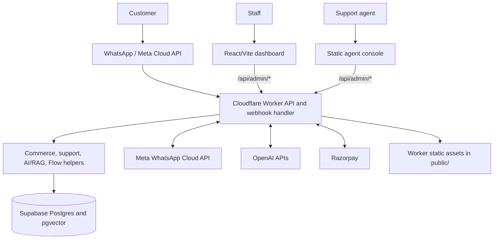
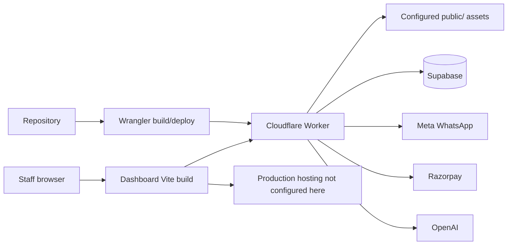

# Project Overview

| Item | Description |
|---|---|
| Project name | WhatsApp Commerce Bot and Customer Care Dashboard |
| Purpose | Enable customers to browse and purcha0.
l..';.ljohygjhfvvgjh,se products, manage delivery details, receive order updates, and get support over WhatsApp; provide staff with tools to inspect and manage commerce and support records. |
| Business problem | Brings customer-facing commerce/support conversations and staff-facing customer/order operations together, while automating routine responses, address collection, payment-link creation, and payment confirmation. |
| Main user types | Customers using WhatsApp; customer-care/admin staff using the dashboard; support agents using the agent console; developers and QA engineers maintaining the services. |

This repository contains one Cloudflare Worker backend and two staff-facing web surfaces: a React/Vite dashboard and a static support-agent console. It is not a set of independently deployed backend microservices.

# High Level Architecture



| Layer | Responsibility |
|---|---|
| User/channel | Customers interact through WhatsApp. Staff use the dashboard; agents can use the separate static support console. |
| Frontend | React pages render customer/order/support views and call the Worker admin API. The agent console calls the same API directly. |
| API/transport | The Cloudflare Worker accepts HTTP requests, dispatches API routes, handles provider webhooks, validates inputs and authorization, and schedules inbound WhatsApp message work. |
| Business services | Commerce and support workflows, AI intent routing, factual commerce lookups, RAG, and WhatsApp Flow construction/parsing. These are modules within the Worker deployment, not separate services. |
| Persistence | Supabase Postgres stores commerce, delivery, conversation, support, and knowledge records; pgvector supports FAQ retrieval. |
| External providers | Meta sends/receives WhatsApp messages; Razorpay creates payment links and reports payment events; OpenAI supports classification, response generation, and embeddings. |

# Technology Stack

## Frontend

- **Framework:** React 19 with JavaScript, bundled and served in development by Vite.
- **State management:** React component state and effects; no dedicated global state library is configured.
- **UI libraries:** Custom CSS; no component UI library is listed in the dashboard dependencies.
- **Routing:** React Router 7.
- **API access:** Fetch-based wrappers in `customer-care-dashboard/src/api/customerApi.js`.

The static support-agent console is plain HTML, CSS, and JavaScript in `public/agent.html`. It is separate from the React dashboard.

## Backend

- **Runtime:** Cloudflare Workers.
- **Language/tooling:** TypeScript; Wrangler for local development and deployment.
- **Framework:** A Worker `fetch` handler with method/path dispatch in `src/index.ts`; there is no separate web framework/router dependency.
- **API architecture:** REST-style admin endpoints, Meta WhatsApp webhooks, a Razorpay webhook, and utility endpoints. Reusable business/data operations live mainly in `src/commerce.ts` and focused service modules.

## Database

- **Database type:** Supabase Postgres, with pgvector for retrieval-augmented FAQ responses.
- **ORM/query layer:** Supabase JavaScript client with PostgREST queries and SQL RPC functions; no conventional ORM is present.
- **Important entities:** Customers, products, carts/items, orders/items, delivery addresses, order delivery details, order status history, notification events, conversation state/context, support sessions/tickets/messages, agent sessions, and RAG documents.
- **Schema management:** Ordered SQL migrations in `supabase/migrations/`; the repository does not define an automated migration command.

## Infrastructure

- **Hosting:** Cloudflare Workers hosts the API and serves files from `public/` as configured in `wrangler.jsonc`.
- **Dashboard hosting:** A Vite dev/build project exists. No production dashboard host or reverse-proxy deployment is defined in this repository.
- **CI/CD:** No repository GitHub Actions workflow or other CI/CD deployment pipeline was identified. The Worker has a Wrangler deployment command; production promotion details are external to this repository.
- **Storage:** Supabase Postgres is the primary application persistence layer. No Cloudflare R2, KV, or D1 binding is configured. Support media references may be stored as application metadata; there is no general object-storage binding in Wrangler.
- **Caching:** No application cache service or cache binding is configured.
- **Background work:** Inbound WhatsApp message processing uses request-attached `ctx.waitUntil(...)`. No Cron Trigger, Queue consumer, or durable background-job service is configured.

# Project Structure

| Path | Purpose |
|---|---|
| `src/index.ts` | Active Worker entry point: request routing, webhook parsing, admin APIs, orchestration, and outbound WhatsApp interactions. |
| `src/commerce.ts` | Supabase-backed commerce, order, delivery-address, payment, notification, and support operations. |
| `src/ai-commerce-router.ts` | OpenAI-assisted commerce intent classification and answer orchestration. |
| `src/commerce-tools.ts` | Deterministic Supabase-backed lookups used to ground commerce answers in business facts. |
| `src/commerce-memory.ts` | Conversation/customer commerce context used to resolve follow-up references. |
| `src/rag.ts` | FAQ document chunking/embedding, vector retrieval, and context-based answer generation. |
| `src/whatsapp-flows.ts` | Delivery-address Flow message construction, submission extraction/normalization, and chat fallback address helpers. |
| `customer-care-dashboard/` | Independent React/Vite project containing the staff dashboard, its pages, styles, and API client. |
| `customer-care-dashboard/src/pages/` | Dashboard screens: overview, customers/details/edit, orders/details, carts/details, conversations, products, and tracking. |
| `customer-care-dashboard/src/api/` | Fetch wrappers for dashboard API calls. |
| `public/` | Worker-served static assets, including `agent.html` and a small sample `index.html`. The React dashboard is not built into this directory by repository configuration. |
| `whatsapp-flows/` | Source JSON definition for the delivery-address Meta Flow. |
| `supabase/migrations/` | Versioned database schema, constraints, indexes, policies, and SQL functions. |
| `scripts/` | Local PDF-to-RAG ingestion command (`ingest-pdf.ts`). |
| `test/` and `src/rag.spec.ts` | Vitest tests for Worker/business/RAG behavior using the Cloudflare Workers test pool. |
| `docs/` | Architecture, onboarding, handover, troubleshooting, and feature-specific documentation. |
| `postman/` | Postman workspace globals/resources for API exploration. |
| `Files/Backup_scripts/`, `src/index.before-ai.ts.backup`, `src/P.js` | Backup/sample material; not configured as active Worker entry points. |
| `wrangler.jsonc` | Worker entry, compatibility settings, `public/` assets, AI binding, and observability configuration. |
| `vitest.config.mts`, `vitest-admin.json`, `tsconfig.json` | Test and TypeScript configuration. |
| `.dev.vars.example`, `.env.example`, `customer-care-dashboard/.env.example` | Environment variable templates; they contain names/placeholders, not production credentials. |

# Frontend Flow

1. The dashboard browser loads `customer-care-dashboard/index.html`; `src/main.jsx` mounts the React application.
2. `src/App.jsx` wraps the application in `BrowserRouter` and maps routes to dashboard pages.
3. Pages use local React state/effects to load records and show loading, error, and data states. Search/filter behavior is generally local to the page.
4. A page calls a function in `src/api/customerApi.js`, which fetches `/api/admin/...`, parses JSON, and throws an error when the HTTP response is unsuccessful.
5. In local development, the Vite proxy forwards `/api` requests to the Worker and adds the configured admin authorization header. This is a local development convenience, not production user authentication.

Main screens:

- `/`: overview counts and recent orders.
- `/customers`, `/customers/:customerId`, `/customers/:customerId/edit`: customer search/list, history, order/address information, and customer edits.
- `/orders`, `/orders/:id`: order listing and detail view.
- `/carts`, `/carts/:id`: cart listing/details.
- `/conversations`: recent WhatsApp conversation context/state.
- `/products`: product catalog management.
- `/tracking`: order status management.

The agent console at `/agent.html` asks the operator for an admin token and agent ID, then polls the waiting queue and active conversation. Its client-side token storage is separate from the React dashboard flow.

# Backend Flow

## Request lifecycle

1. Cloudflare invokes the Worker fetch handler, which logs the request method/path and dispatches based on URL and method.
2. Admin routes check the shared `ADMIN_API_TOKEN` bearer authorization. Webhook routes parse provider-specific payloads and validate applicable signatures.
3. Route logic validates fields and invokes commerce, support, AI, or Flow helper functions.
4. Service functions use Supabase queries/RPCs or call the relevant provider.
5. The Worker returns an HTTP/JSON response for synchronous API requests. For WhatsApp inbound messages, it acknowledges the callback and schedules the conversation processing through `ctx.waitUntil(...)`; later failures are visible in Worker logs rather than the original webhook response.

## Route, controller, service, and data-access responsibilities

- **Route/controller layer:** `src/index.ts` combines route dispatch, request validation, authorization, workflow orchestration, provider messaging, and response/error formatting. There is no separate controller framework.
- **Service layer:** `commerce.ts` handles database-backed domain operations. Other focused modules handle commerce AI, memory, RAG, and WhatsApp Flow concerns.
- **Data access:** The Supabase client issues direct PostgREST reads/writes; selected aggregate operations use SQL RPCs. The manual CRM order path uses `create_admin_order()` in the database.
- **Error behavior:** Validation/provider/database errors are logged and surfaced as route-specific errors or customer-facing messages. Several AI/RAG paths intentionally return a low-confidence fallback when retrieval or generation fails.

# Authentication & Authorization

- **Customer login:** No customer account login or application session/token flow is present. The WhatsApp sender number is the principal identifier for customer conversations, and customer records are resolved/associated by phone and/or database customer ID.
- **Dashboard staff:** Admin endpoints require a shared bearer token configured as `ADMIN_API_TOKEN`. There are no per-user identities or role-based permissions in the inspected implementation.
- **Local dashboard auth:** The local Vite proxy reads `ADMIN_API_TOKEN` from `customer-care-dashboard/.env.local` and attaches it server-side to API requests. Do not expose this value through a `VITE_*` browser variable.
- **Agent console:** Operators enter the shared admin token and an agent ID. The static console stores the token and agent ID in browser `localStorage`; this is not equivalent to a managed identity/login system.
- **Meta webhook verification:** `GET /webhook` validates Meta's subscription handshake using a verification token currently defined in source, not a configurable environment binding. Status callbacks validate `X-Hub-Signature-256` when `WHATSAPP_APP_SECRET` is configured; the active code does not apply the same signature check to ordinary inbound message callbacks.
- **Razorpay webhook verification:** `POST /razorpay-webhook` validates the HMAC signature over the raw request body using `RAZORPAY_WEBHOOK_SECRET`.
- **Supabase access:** Worker paths use server-side credentials, including the service-role key for privileged operations. Service-role calls bypass normal row-level security enforcement, so authorization must be enforced at the application/API boundary.
- **CORS:** The Worker allows configured local development origins. CORS is not an authentication mechanism.

# API Documentation Summary

The admin API routes below use bearer-token authorization. Paths with braces represent route parameters.

| Endpoint | Method | Purpose | Authentication Required |
|---|---|---|---|
| `/api/admin/customers` | GET | List customers and summary data. | Admin bearer token |
| `/api/admin/customers` | POST | Create a customer. | Admin bearer token |
| `/api/admin/customers/{customerId}` | GET, PATCH | Read or update a customer. | Admin bearer token |
| `/api/admin/customers/{customerId}/history` | GET | Aggregate commerce and support history. | Admin bearer token |
| `/api/admin/customers/{customerId}/orders` | GET, POST | List customer orders or create a manual order. | Admin bearer token |
| `/api/admin/customers/{customerId}/addresses` | GET, POST | List/create saved delivery addresses. | Admin bearer token |
| `/api/admin/customers/{customerId}/addresses/{addressId}/default` | PATCH | Select the customer's default address. | Admin bearer token |
| `/api/admin/orders` | GET | List orders, item/customer details, and status history. | Admin bearer token |
| `/api/admin/orders/{orderId}/status` | POST | Transition order status and trigger applicable notifications. | Admin bearer token |
| `/api/admin/orders/{orderId}/delivery-status` | POST | Update delivery status. | Admin bearer token |
| `/api/admin/products` | GET | List products. | Admin bearer token |
| `/api/admin/products/{productId}` | PATCH | Update supported product fields. | Admin bearer token |
| `/api/admin/carts` | GET | List carts and cart items. | Admin bearer token |
| `/api/admin/conversations` | GET | Read recent conversation contexts and states. | Admin bearer token |
| `/api/admin/tickets` | GET | List support tickets. | Admin bearer token |
| `/api/admin/tickets/{ticketId}` | GET, PATCH | Read a ticket or update its status. | Admin bearer token |
| `/api/admin/tickets/{ticketId}/messages` | GET, POST | Read ticket messages or send/store a reply. | Admin bearer token |
| `/api/admin/tickets/{ticketId}/reply` | POST | Send and record a ticket reply. | Admin bearer token |
| `/api/admin/agent-queue` | GET | Read waiting agent sessions and context. | Admin bearer token |
| `/api/admin/agent-sessions/{sessionId}/accept` | POST | Accept/assign a waiting agent session. | Admin bearer token |
| `/api/admin/agent-sessions/{sessionId}/reply` | POST | Send a reply as the assigned agent. | Admin bearer token |
| `/api/admin/agent-sessions/{sessionId}/end` | POST | End an agent session. | Admin bearer token |
| `/webhook` | GET | Meta WhatsApp webhook verification handshake. | Provider verification token |
| `/webhook` | POST | Receive WhatsApp messages, Flow submissions, and status callbacks. | Provider callback; signature verification differs by callback type |
| `/razorpay-webhook` | POST | Verify payment events and update order/payment state. | Razorpay HMAC signature |
| `/message`, `/random`, `/ai-test` | GET | Sample greeting, UUID, and RAG test routes. | No admin bearer token |

Check active dispatch in `src/index.ts` before relying on a path from an older test or client helper. Some legacy route references in repository docs/tests do not match active dispatch.

# Database Overview

Supabase Postgres is the shared source of persistent application data. The numbered migrations under `supabase/migrations/` are the schema history and should be checked before modifying any record lifecycle.

| Domain | Representative tables | Relationships and role |
|---|---|---|
| Customers/catalog | `customers`, `products` | Customer records connect commerce and support history; products provide catalog, price, and inventory facts. |
| Cart/checkout | `carts`, `cart_items` | Carts contain product selections associated primarily with customer phone. |
| Orders | `orders`, `order_items`, `order_status_history`, `notification_events` | Checkout/manual order creation produces order records and items; status history and notification events track downstream changes. |
| Delivery | `delivery_addresses`, `order_delivery_details` | Customers can save multiple addresses; an order may link to a saved address and delivery lifecycle record. |
| Conversations | `conversation_state`, `conversation_context`, `customer_profiles`, `processed_webhook_events` | Persistent WhatsApp progress, follow-up context, profile facts, and webhook bookkeeping. |
| Support | `support_sessions`, `support_session_media`, `support_tickets`, `ticket_messages`, `support_messages`, `support_agent_sessions` | Tracks issue intake, ticket state, customer/agent message history, media metadata, and agent assignment. |
| Knowledge | `rag_documents`, `knowledge_base` | Active FAQ retrieval uses `rag_documents` and pgvector. `knowledge_base` is a legacy keyword-oriented table and is not the active RAG retrieval source. |

The data model uses both numeric IDs and WhatsApp phone numbers for association. Customer-history logic may need to reconcile both. Database migrations include RLS policies, but privileged service-role calls are not constrained like browser/anon calls.

# External Integrations

| Integration | Purpose and use | Data flow |
|---|---|---|
| **Supabase** | Shared Postgres persistence and pgvector search. Used by the Worker, RAG retrieval, and local document ingestion. | Worker reads/writes records through Supabase JS/PostgREST and SQL RPCs. The ingestion script stores text chunks and embeddings in `rag_documents`. |
| **Meta WhatsApp Cloud API** | Customer channel and outbound notifications. | Meta posts message/status/Flow callbacks to `/webhook`; the Worker routes responses through the Graph API `/messages` endpoint. A configured published Delivery Address Flow collects structured address data; without a Flow ID, chat-based collection is used. |
| **Razorpay** | Checkout payment links and payment confirmation. | Worker creates a payment link after address/order persistence, sends it in WhatsApp, and handles signed payment callbacks at `/razorpay-webhook`. |
| **OpenAI** | Commerce intent classification, factual answer generation, embeddings, and FAQ responses. | Worker sends intent/answer requests and embedding requests. RAG queries Supabase pgvector for relevant document chunks before generating a context-bound answer. |
| **Cloudflare Workers** | Hosts the API runtime and configured static assets, and provides request-attached background execution. | Wrangler deploys the Worker. `ctx.waitUntil(...)` lets inbound WhatsApp processing continue after webhook acknowledgement. |

The Wrangler config declares an `AI` binding, but the inspected commerce/RAG model calls use OpenAI HTTP APIs; do not assume the deployed FAQ path uses Workers AI inference. No email integration was identified.

# Environment Variables

Variable names and purposes are listed below; **values are intentionally omitted**. Use `.dev.vars.example` and the relevant `.env.example` files as templates.

| Variable | Purpose | Required By |
|---|---|---|
| `SUPABASE_URL` | Selects the Supabase project. | Worker database features and PDF ingestion |
| `SUPABASE_ANON_KEY` | Public/anon Supabase client credential. | Public-key product paths that use it |
| `SUPABASE_SERVICE_ROLE_KEY` | Server-side privileged database credential. | Worker privileged access and PDF ingestion |
| `WHATSAPP_TOKEN` | Authorizes outbound Meta Graph API calls. | WhatsApp messaging |
| `PHONE_NUMBER_ID` | Identifies the WhatsApp business phone API endpoint. | Outbound WhatsApp messages |
| `WHATSAPP_APP_SECRET` | Verifies applicable Meta webhook signatures. | WhatsApp status callback signature validation |
| `WHATSAPP_DELIVERY_FLOW_ID` | Published Flow identifier; optional. | Native delivery address Flow launches |
| `RAZORPAY_KEY_ID` | Razorpay API credential identifier. | Payment-link creation |
| `RAZORPAY_KEY_SECRET` | Razorpay API credential secret. | Payment-link creation |
| `RAZORPAY_WEBHOOK_SECRET` | Verifies Razorpay callback signatures. | Payment callback processing |
| `OPENAI_API_KEY` | Authenticates OpenAI model/embedding requests. | AI commerce, RAG, and PDF ingestion |
| `OPENAI_CHAT_MODEL` | Optional chat model override. | Worker AI paths |
| `RAG_MATCH_THRESHOLD` | Optional vector match threshold. | FAQ/RAG retrieval |
| `ADMIN_API_TOKEN` | Shared bearer token for admin APIs. | Worker admin APIs and local dashboard proxy |
| `SUPPORT_WHATSAPP_NUMBER` | Destination for the direct support-chat CTA. | WhatsApp support handoff |
| `AI` | Cloudflare Workers AI binding declared in Wrangler. | Worker runtime binding; current RAG path uses OpenAI |
| `VITE_API_PROXY_TARGET` | Overrides the Worker target for local Vite `/api` proxying. | Dashboard local development |

The PDF ingestion script also loads `.env` through dotenv and requires `SUPABASE_URL`, `SUPABASE_SERVICE_ROLE_KEY`, and `OPENAI_API_KEY`. Meta's `GET /webhook` verification token is currently a source constant, not an environment variable. Never place service-role credentials or admin tokens in public frontend variables or source control.

# End-to-End User Journey

Example: a WhatsApp customer adds an item to their cart and checks out.

1. **User action:** The customer messages the business, browses products, adds an item, and chooses checkout.
2. **Channel and request:** Meta sends each inbound WhatsApp message/button reply to `POST /webhook`.
3. **Backend processing:** The Worker acknowledges the webhook, then processes the message under `ctx.waitUntil(...)`. It resolves the sender/customer and current conversation state, applies the relevant cart/checkout branch, and loads saved delivery addresses.
4. **Address collection:** The customer selects a saved address or submits the published WhatsApp Flow. The Worker extracts and normalizes Flow fields (or uses chat-based collection when the Flow is not configured) and validates required address fields.
5. **Persistence and checkout:** The Worker saves/links the delivery address, creates the order and order items, initializes delivery details, and updates checkout/cart state in Supabase. These provider/database operations do not share one transaction.
6. **Payment:** The Worker creates a Razorpay payment link, records its ID/URL and pending payment state, then sends the link through WhatsApp.
7. **Payment completion:** Razorpay calls `/razorpay-webhook`; the Worker verifies its signature, updates payment/order state, and continues applicable fulfillment messaging.
8. **Staff visibility:** The dashboard reads customer/order/support data through authenticated `/api/admin/*` calls backed by Supabase.

# Error Handling

- **Input validation:** The Worker validates request bodies and domain values (for example address fields, phone numbers, PIN codes, order status transitions, and agent IDs). WhatsApp Flow field aliases are normalized before address validation.
- **API responses:** Admin endpoints return JSON with HTTP status codes appropriate to invalid input, unauthorized requests, missing records, conflicts, and server/provider errors. The dashboard API wrapper surfaces response errors to page-level UI.
- **Webhook parsing:** Invalid webhook JSON is rejected. WhatsApp message work is asynchronous relative to the webhook acknowledgement, so a `200` from Meta means the callback was accepted, not that every later database/provider operation succeeded.
- **Payment verification:** Razorpay callback signatures are checked; invalid signatures are rejected. Duplicate paid-state handling is guarded in the payment path.
- **Provider and database errors:** Supabase helper errors generally throw and are logged/translated by route/workflow code. OpenAI/RAG paths have explicit low-confidence fallback behavior for selected retrieval or generation failures.
- **Retry behavior:** No general retry queue or scheduled retry system is configured. WhatsApp inbound work uses `ctx.waitUntil(...)`; payment events can be redelivered by the provider, so webhook idempotency/state guards matter.
- **Logging:** The Worker logs request/route and workflow errors to Cloudflare observability. Current Flow diagnostics include raw webhook/extracted/normalized payload logs, which can contain personal data; restrict log access and retention. Never log credentials.
- **Partial checkout failures:** The checkout sequence spans multiple calls and is not one database transaction. An order/address may remain persisted if later payment-link generation fails; the customer is directed to support with the order context.

# Deployment Architecture



- `wrangler.jsonc` sets `src/index.ts` as the Worker entry point, `public/` as the static assets directory, runtime compatibility flags/date, the `AI` binding, and observability/source-map settings.
- `npm run deploy` invokes `wrangler deploy` for the Worker. This does not apply database migrations or establish a production dashboard host.
- `npm run dev` starts the Worker locally, normally on `http://localhost:8787`. The dashboard has its own Vite dev server, normally on `http://localhost:5173`.
- The dashboard's local `/api` proxy targets the Worker and injects the configured admin token. Production frontend hosting/proxying must be configured outside this repository without bundling the shared token.
- Supabase schema setup is performed from the ordered SQL migrations against the target project. The project selected by `SUPABASE_URL` must match the database where migrations were applied.
- Meta and Razorpay webhook URLs/secrets, the published Meta Flow ID, and provider-side setup must be configured in their respective consoles and Cloudflare Worker environment.
- No in-repository CI/CD workflow, Cron Trigger, queue consumer, or automatic migration deployment was identified.

# Key Design Decisions

- **WhatsApp-first customer interaction:** Uses Meta's existing customer messaging channel rather than requiring customers to install a dedicated application.
- **One Worker orchestration boundary:** Keeps webhook, admin API, and provider orchestration in one deployable runtime, with helper modules for domain/service concerns.
- **Supabase as shared persistence:** Both customer conversation workflows and staff dashboard APIs read/write the same Postgres-backed commerce/support records.
- **Persistent conversation state:** Multi-message WhatsApp flows can resume across separate webhook invocations and Worker isolates.
- **AI grounded by application data:** Commerce intent classification delegates factual answers to Supabase-backed tools; FAQ answers use retrieved document context rather than treating an LLM as the system of record.
- **Native Flow plus chat fallback:** A published Meta Flow offers structured address collection; the existing text collection path remains available if a Flow ID is not configured.
- **Payment link workflow:** Razorpay Payment Links keep payment collection outside the bot while signed callbacks update the order.
- **SQL RPC for manual CRM orders:** Aggregate manual order creation is grouped in a database function; the WhatsApp checkout workflow crosses multiple operations and is not transactional as a whole.
- **Shared admin token:** A simple bearer-token boundary is used instead of a user/role identity system. This is an observed implementation choice and should not be mistaken for per-operator authorization.

# Quick Start for New Developers

## Required software

- Node.js and npm compatible with the installed Wrangler/Vite toolchain.
- Access to a development Supabase project and required provider credentials for the workflows being tested.
- Cloudflare Wrangler account access only when deploying the Worker.

## Install and configure

1. From the repository root, install Worker dependencies:

   ```powershell
   npm install
   ```

2. Copy `.dev.vars.example` to `.dev.vars` and populate only the local values needed for your development workflows. Keep `.dev.vars` private and untracked.
3. Apply the numbered SQL migrations in `supabase/migrations/` to the intended Supabase development project.
4. For dashboard development, install its dependencies and configure its local proxy:

   ```powershell
   Set-Location customer-care-dashboard
   npm install
   Copy-Item .env.example .env.local
   ```

   Set `ADMIN_API_TOKEN` in `customer-care-dashboard/.env.local` to match the Worker local token. Set `VITE_API_PROXY_TARGET` only when the Worker is not at the default URL.

## Run locally

Run the Worker from the repository root:

```powershell
npm run dev
```

In another terminal, run the dashboard:

```powershell
Set-Location customer-care-dashboard
npm run dev
```

Open the Vite URL shown in the terminal. The agent console is served by the Worker at `/agent.html` when local static asset serving is active.

## Important commands

| Command | Purpose |
|---|---|
| `npm run dev` | Start the local Worker with Wrangler. |
| `npm test` | Run Worker/service Vitest tests. |
| `npm run cf-typegen` | Regenerate Cloudflare Worker binding types after binding changes. |
| `npm run ingest -- <pdf-or-directory>` | Ingest PDF knowledge into the RAG store. |
| `npm run deploy` | Deploy the Worker using Wrangler. |
| `npm run build` (from dashboard folder) | Build the dashboard with Vite. |
| `npm run lint` (from dashboard folder) | Run ESLint on the dashboard. |
| `npm run preview` (from dashboard folder) | Preview the production dashboard build locally. |

Before changing a workflow, trace its active route in `src/index.ts`, relevant database behavior in `src/commerce.ts`, migrations, dashboard API wrappers if applicable, and focused tests.

# Glossary

| Term | Meaning |
|---|---|
| **Worker** | Cloudflare's serverless JavaScript/TypeScript runtime hosting the API and webhook handler. |
| **WABA** | WhatsApp Business Account associated with the Meta WhatsApp Cloud API. |
| **Flow** | A structured interactive form rendered in WhatsApp; this project uses one to collect delivery addresses. |
| **Webhook** | Provider-initiated HTTP callback for WhatsApp messages/statuses or Razorpay payment events. |
| **Conversation state/context** | Persisted values used to determine a customer's current bot step and resolve follow-up references. |
| **Admin API token** | Shared bearer secret required by the Worker’s `/api/admin/*` routes. It is not an individual account or role. |
| **RAG** | Retrieval-augmented generation: retrieve relevant knowledge chunks, then generate an answer grounded in them. |
| **pgvector** | Postgres extension used to store and compare embedding vectors for semantic document retrieval. |
| **Payment link** | Razorpay-hosted payment URL created for an order and sent to the customer. |
| **`ctx.waitUntil(...)`** | Cloudflare Worker mechanism used here to continue webhook message processing after the immediate HTTP response. It is not a durable queue. |

# Executive Summary

This project supports WhatsApp-based commerce and customer care. Customers browse products, manage carts, check orders, provide delivery details, receive Razorpay payment links, and contact support through WhatsApp. Staff inspect and manage customers, orders, products, carts, conversations, and tracking through a React dashboard. Support agents also have a separate static console.

One Cloudflare Worker is the backend entry point for admin APIs and Meta/Razorpay webhooks. It orchestrates business logic in TypeScript modules and persists application data in Supabase Postgres. OpenAI provides commerce intent/answer generation and embeddings; FAQ answers retrieve document chunks from Supabase pgvector. Delivery addresses can be collected through a published Meta WhatsApp Flow or a chat-based fallback.

Local development runs the Worker with Wrangler and the dashboard with Vite. The repository provides SQL migrations, example environment files, and Vitest coverage, but does not define production dashboard hosting, CI/CD, automated schema deployment, or a durable background queue. Admin API access uses a shared bearer token rather than per-user accounts/roles. Production setup therefore depends on correct Cloudflare secrets, Supabase migrations, Meta webhook/Flow configuration, Razorpay webhook configuration, OpenAI credentials, and an external plan for dashboard hosting and staff authentication.
